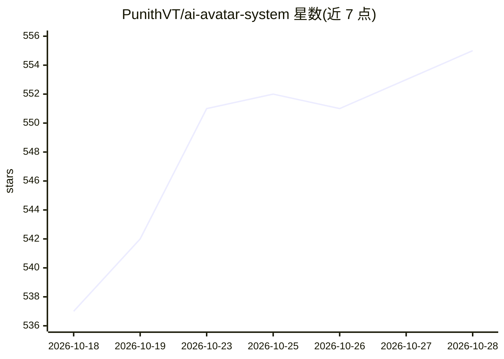

# PunithVT/ai-avatar-system

⭐ 555 · Python · MIT · 推送 2026-09-18 · [GitHub](https://github.com/PunithVT/ai-avatar-system) · [官网](https://github.com/sponsors/PunithVT) · 个人维护

**自托管实时 AI 数字人对话平台：照片+声音克隆生成唇形同步视频**

开源的 AI 头像/数字人对话平台：用户上传人脸照片、录制 10 秒音频克隆声音，即可与头像实时对话，每条回复经 Chatterbox TTS 与 MuseTalk 生成唇形同步视频。管线为 Whisper STT → LLM（Claude/GPT-4o/Ollama/vLLM/LM Studio，流式）→ TTS → 唇形同步，支持打断、23 种语言、100% 本地模式。后端 FastAPI + Postgres + Celery，前端 Next.js，提供 Docker Compose 部署与 AWS GPU 一键部署脚本；实时性能需 GPU（g5.xlarge 约 30 FPS），CPU 下 MuseTalk 慢 30–50 倍。

## 筛选速览

| 维度 | 判定 | 备注 |
|---|---|---|
| AI 角色 | `ai-native` | 本体是模型或模型工具 |
| 许可风险 | `permissive` | MIT |
| 部署形态 | `self-host` | docker 或自建部署 |
| 模型依赖 | local-ok | 支持本地模型 |
| 硬件要求 | — | 无带数字的原话,不猜 |
| 安装摩擦 | `low` | 无编译、无系统依赖或容器化 |
| 成熟度 | — | 结构信号不足 |

## 能力要点

- 照片上传 + 10 秒音频零样本声音克隆，实时唇形同步视频对话
- 多 LLM 后端：Claude/GPT-4o/Ollama/vLLM/LM Studio，支持流式与打断
- TTS 回退链 chatterbox→edge-tts→gTTS，对话记忆用摘要而非向量库
- Docker Compose 本地部署与 AWS GPU（CUDA/float16）一键部署，含 JWT 认证与测试套件

## 适用场景

- 搭建可对外服务的多用户数字人对话 Web 应用
- 用本地 Ollama + Whisper 做完全离线的 AI 头像对话
- 为客服、演示等场景生成带克隆语音与唇形同步的实时视频回复

## 场景标签

`语音 Agent` `语音合成` · 领域:对话与助手

## 证据(README 行号)

> L23: AvatarAI is an open-source, production-ready platform for building **photorealistic AI avatar conversations**. Uplo
> L26: [mic] → Whisper STT → Claude / GPT / Ollama (streaming) → Chatterbox TTS → MuseTalk lip-sync → [video]

## 星数曲线

2026-10-18 537 → 2026-10-28 555（+18）

---
*卡片 v1 · prompt 1.4 · 生成 2026-10-22 · 置信度 mid · 依据 README sha `b6f3a535f47a` · [字段定义](../../DATASET.md)*
