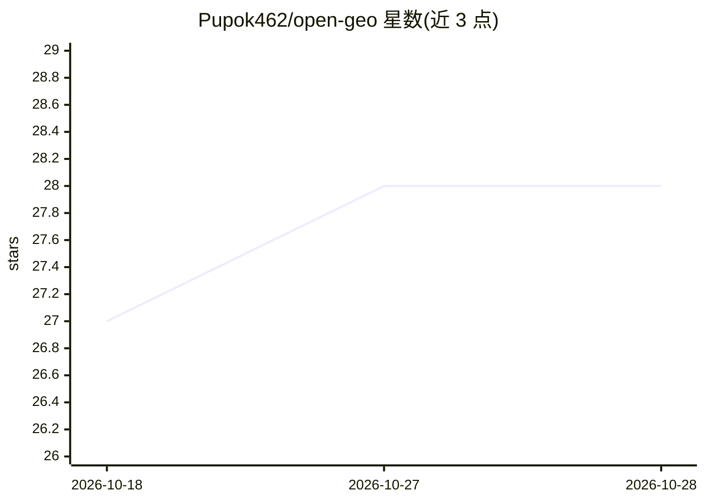

# Pupok462/open-geo

⭐ 28 · Python · MIT · 推送 2026-10-24 · [GitHub](https://github.com/Pupok462/open-geo) · [官网](https://pupok462.github.io/open-geo/) · 个人维护 · 中文 README

**测量品牌在七大 AI 引擎答案中可见度的 agent 技能**

以 agent skill 形式打包的 GEO/AI 可见度数据采集工具：在真实登录的可见浏览器中读取 Google AI Overview、ChatGPT、Claude、Gemini、Yandex Alice、DeepSeek、Perplexity 的渲染答案，按查询记录目标域名是否进入来源、引用或正文，并输出漏斗指标、品牌提及率、定性情绪与域名排行榜。采集由 agent 按自然语言 playbook 执行，结果存入本地 SQLite 并导出 JSON 工件，可选 FastAPI+React 仪表盘与 PDF 报告。定位为按需审计而非持续监控，单次运行限于数十到数百查询。面向 GEO/SEO 顾问与品牌增长团队。

## 筛选速览

| 维度 | 判定 | 备注 |
|---|---|---|
| AI 角色 | `ai-ecosystem` | LLM/agent 周边工具 |
| 许可风险 | `permissive` | MIT |
| 部署形态 | `None` |  |
| 模型依赖 | — | README 未给出锁定关系 |
| 硬件要求 | — | 无带数字的原话,不猜 |
| 安装摩擦 | `low` | 无编译、无系统依赖或容器化 |
| 成熟度 | — | 结构信号不足 |

## 能力要点

- 读取登录浏览器中的渲染答案，覆盖七个引擎（含 Yandex Alice、DeepSeek）
- 每查询记录来源/引用/正文三级可见性，输出七项指标与域名排行榜
- agent 按自然语言 playbook 采集，引擎 UI 变更仅需改 markdown 文件
- 本地 SQLite 存储 + 便携 JSON 工件，可选四语言仪表盘与 PDF 报告

## 适用场景

- 审计我的品牌在 ChatGPT/Perplexity 等 AI 答案中的出现情况
- 按查询视角（通用/品牌/对比）跟踪域名在 AI 答案中的周度变化
- 用渲染答案作为基准，校验自建 API/爬虫管线的相关性

## 场景标签

`网页抓取` `浏览器自动化` · 领域:效率与自动化

## 证据(README 行号)

> L34: |**What it is**|A GEO / AI-visibility data-collection agent for a brand or URL, packaged as a composable **skill**|
> L37: |**What it reports**|A funnel — answer coverage → visibility in sources → visibility in citations — plus positions,
> L40: |**Requirements**|A supported agent host with visible-browser control and a browser logged in to the engine. No dat

## 星数曲线

2026-10-18 27 → 2026-10-28 28（+1）

---
*卡片 v1 · prompt 1.4 · 生成 2026-10-26 · 置信度 high · 依据 README sha `62fe8ed105cf` · [字段定义](../../DATASET.md)*
