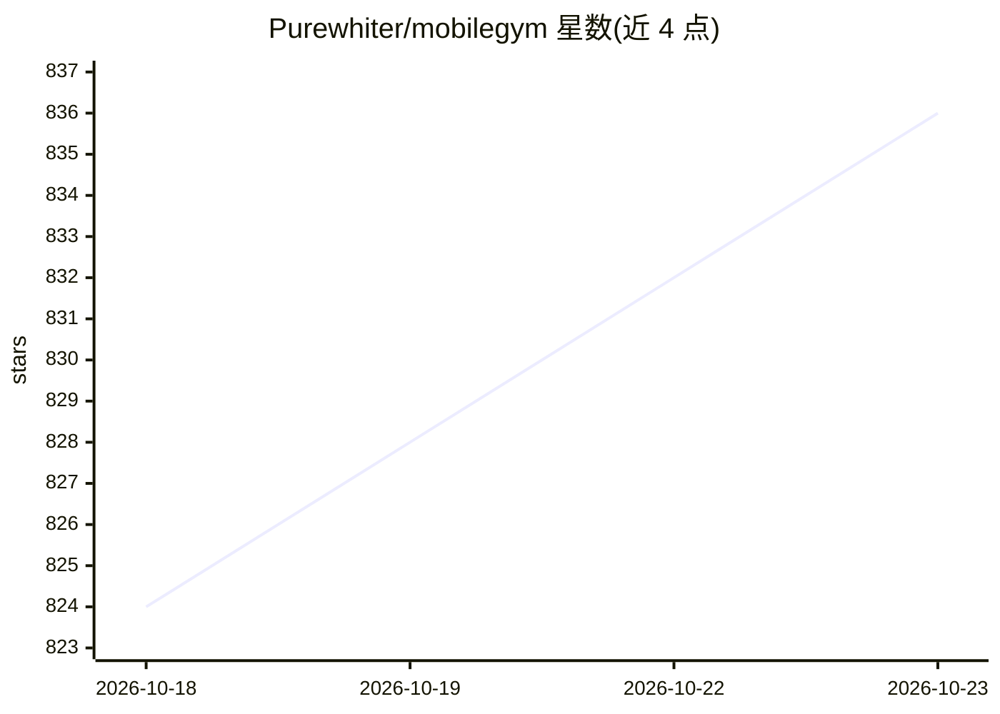

# Purewhiter/mobilegym

⭐ 836 · Python · Apache-2.0 · 推送 2026-10-09 · [GitHub](https://github.com/Purewhiter/mobilegym) · [官网](https://mobilegym.dev) · 组织维护 · 中文 README

**移动 GUI agent 的可验证高并行浏览器仿真评测与在线 RL 平台**

面向移动 GUI agent 研究的仿真环境：在浏览器中运行 28 个模拟 App（微信、支付宝、12306 等）与 416 个参数化任务模板，整个环境以结构化 JSON 表示，支持快照、重置、克隆与并行实例；每任务配程序化判定函数，无需 VLM 评委。提供 Python 基准层（Playwright）、在线 RL 训练代码（GRPO，v0.1.0 起）与排行榜（9 个 agent）。论文被 EMNLP 2026 主会接收。需 Node ≥ 22 与 Python ≥ 3.11，数据集为 CC BY-NC 4.0。

## 筛选速览

| 维度 | 判定 | 备注 |
|---|---|---|
| AI 角色 | `ai-ecosystem` | LLM/agent 周边工具 |
| 许可风险 | `permissive` | Apache-2.0 |
| 部署形态 | `None` |  |
| 模型依赖 | — | README 未给出锁定关系 |
| 硬件要求 | — | 无带数字的原话,不猜 |
| 安装摩擦 | `low` | 无编译、无系统依赖或容器化 |
| 成熟度 | — | 结构信号不足 |

## 能力要点

- 28 个模拟 App 与 416 个参数化任务模板，状态为结构化 JSON 可快照/重置/克隆
- 每任务程序化确定性判定函数，亚毫秒级判定
- 单服务器可跑 256 并行实例（约 400 MB RAM/实例），256 任务评测约 6 分钟
- Sim-to-Real 验证：Qwen3-VL-4B GRPO 训练增益 95.1% 迁移到真机

## 适用场景

- 评测移动 GUI agent 在多 App 任务上的成功率
- 对 GUI agent 做可扩展的在线强化学习训练
- 用浏览器直接体验和调试 agent 任务环境

## 场景标签

`模型评测` `强化学习` · 领域:评测与运维

## 证据(README 行号)

> L1: MobileGym — Program Mobile Worlds. Train GUI Agents. Verify by State. A verifiable and highly parallel simulation pl
> L21: > **TL;DR** — MobileGym is a browser-hosted mobile simulation environment with **fully programmable state**. It shi
> L192: │ 🧪 Benchmark Layer  (bench_env/, Python + Playwright)              │

## 星数曲线

2026-10-18 824 → 2026-10-23 836（+12）

---
*卡片 v1 · prompt 1.4 · 生成 2026-10-21 · 置信度 high · 依据 README sha `78848bd924b3` · [字段定义](../../DATASET.md)*
