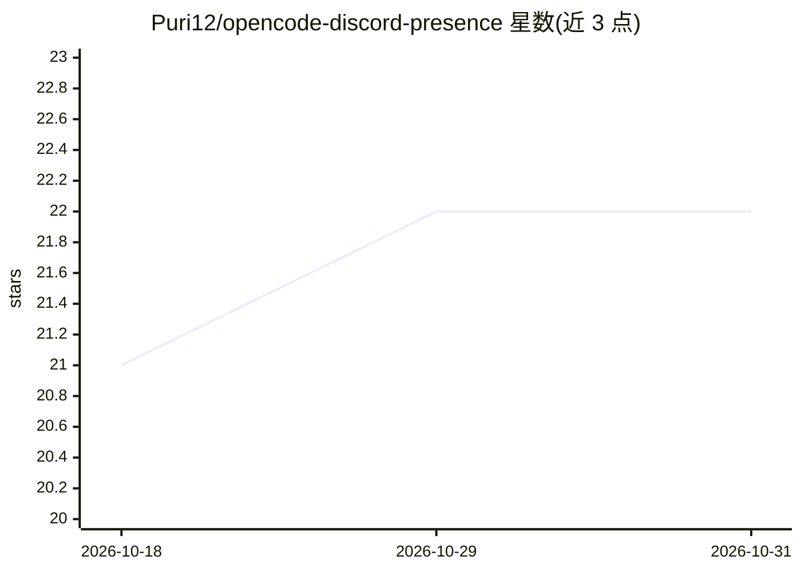

# Puri12/opencode-discord-presence

⭐ 22 · TypeScript · MIT · 推送 2026-10-08 · [GitHub](https://github.com/Puri12/opencode-discord-presence) · 个人维护

**在 Discord 展示 OpenCode AI 编程会话状态的插件**

TypeScript 编写的 OpenCode 插件，通过 Discord Rich Presence 展示当前使用的 AI agent、活动模型、提示/文件活动。挂接 OpenCode 事件系统（chat.message、tool.execute、file.edited、todo.updated、session.idle 等），提供实时文件聚焦、任务进度板、空闲检测、会话回顾卡片，信息卡片默认每 20 秒轮换，关键状态置顶。支持英文/韩文显示，通过 .discord-presence.json 或环境变量配置；限制：OpenCode 插件 API v1 不暴露诊断计数，相关显示需外部 LSP 配置。

## 筛选速览

| 维度 | 判定 | 备注 |
|---|---|---|
| AI 角色 | `ai-ecosystem` | LLM/agent 周边工具 |
| 许可风险 | `permissive` | MIT |
| 部署形态 | `None` |  |
| 模型依赖 | — | README 未给出锁定关系 |
| 硬件要求 | — | 无带数字的原话,不猜 |
| 安装摩擦 | `low` | 无编译、无系统依赖或容器化 |
| 成熟度 | — | 结构信号不足 |

## 能力要点

- 挂接 OpenCode 事件系统跟踪 agent、模型与文件操作
- 实时文件聚焦、任务进度板（如 2/5）与会话回顾卡片
- 关键状态置顶、信息卡片 20 秒轮换、空闲检测
- 韩语助词自动处理与文件路径隐私开关（默认关闭）

## 适用场景

- 在 Discord 个人资料展示我正在使用的 AI 编程 agent 与模型
- 让 Discord 好友实时看到我的编码会话进度与空闲状态
- 用自定义 Discord 应用与素材做品牌化展示

## 场景标签

 · 领域:开发者工具/AI 编程助手生态

## 证据(README 行号)

> L8: Display your current OpenCode session status in Discord Rich Presence. Show which AI agent you're using, the current
> L127: The plugin hooks into OpenCode's event system:

## 星数曲线

2026-10-18 21 → 2026-10-31 22（+1）

---
*卡片 v1 · prompt 1.4 · 生成 2026-10-28 · 置信度 high · 依据 README sha `8101dae544fe` · [字段定义](../../DATASET.md)*
