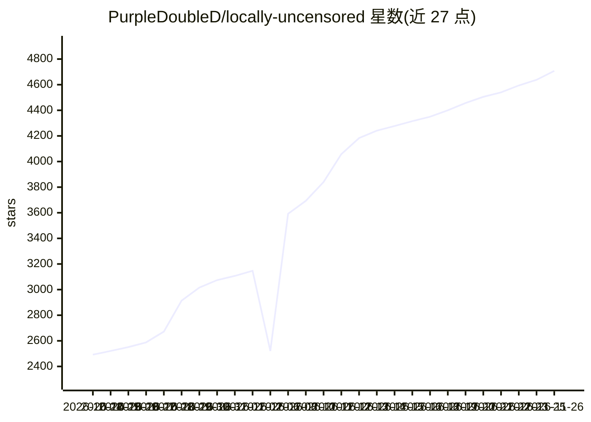

# PurpleDoubleD/locally-uncensored

⭐ 4,708 · TypeScript · AGPL-3.0 · 推送 2026-11-24 · [GitHub](https://github.com/PurpleDoubleD/locally-uncensored) · [官网](https://locallyuncensored.com) · 个人维护

**本地运行的一体式 AI 桌面应用：聊天、图像视频生成与编码 agent**

面向桌面端的开源（AGPL-3.0）AI 应用，将聊天、图像/视频生成（通过应用自动安装和管理的 ComfyUI）、编码 agent（按 hunk 审查 diff、运行测试、.lurules 项目规则）与通用 agent（网页搜索、文件读写、shell、MCP 服务器、权限门控）集成在单一窗口中。本地模式不依赖 Docker、终端或云服务，支持 Windows/Linux 安装包、macOS dmg 与 Android APK；本地模型可复用已有的 Ollama 或 LM Studio 存储。可选 LU Cloud 以积分或订阅方式在托管 GPU 上运行大模型，本地模式保持免费。

## 筛选速览

| 维度 | 判定 | 备注 |
|---|---|---|
| AI 角色 | `ai-native` | 本体是模型或模型工具 |
| 许可风险 | `dual` | AGPL-3.0 |
| 部署形态 | `desktop` | 安装包/桌面程序 |
| 模型依赖 | local-ok | 支持本地模型 |
| 硬件要求 | — | 无带数字的原话,不猜 |
| 安装摩擦 | `low` | 无编译、无系统依赖或容器化 |
| 成熟度 | — | 结构信号不足 |

## 能力要点

- 一键安装 AI 引擎与 ComfyUI，无需 Docker、终端或配置文件
- 编码 agent：diff 预览、测试执行、按项目 .lurules 规则
- 本地 OpenAI 兼容 API 地址，将本地模型暴露给其他工具
- 模型管理器按硬件标记适配模型并一键下载

## 适用场景

- 在个人电脑上离线运行聊天、图像和视频生成
- 不想配置 Docker 和终端的本地 AI 入门使用
- 用编码 agent 修改本地仓库代码并审查 diff
- 手机通过局域网或 Cloudflare 隧道访问桌面端模型

## 场景标签

`编码 Agent` `图像生成` `视频生成` `推理引擎` · 领域:编码与开发

## 证据(README 行号)

> L30: - **What it is:** one desktop app for AI on your own machine: chat, a coding agent, images and video. Free and open
> L31: - **Who it is for:** anyone who wants local AI without a terminal, Docker or config files, from first try to daily 
> L101: **Create.** Images and video on your own GPU through a ComfyUI the app installs, starts, repairs and updates for y

## 星数曲线

2026-10-24 2,492 → 2026-11-26 4,708（+2,216）

---
*卡片 v1 · prompt 1.4 · 生成 2026-11-22 · 置信度 high · 依据 README sha `c8a63ec76d55` · [字段定义](../../DATASET.md)*
