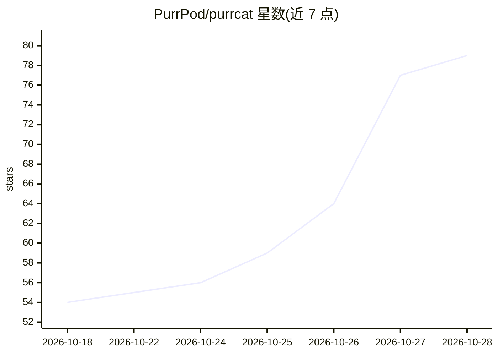

# PurrPod/purrcat

⭐ 79 · Python · MIT · 推送 2026-10-26 · [GitHub](https://github.com/PurrPod/purrcat) · [官网](https://purrpod.github.io/) · 组织维护

**以信息流为核心的自我托管 Agent 基础框架**

面向开发者的 Agent 基础设施：核心理念是围绕信息如何进入、流动与留存来组织 Agent，而非仅依赖模型能力。提供 UI 插件通道、YAML 配置的 DAG 工作流、多层混合记忆（短期/情景/语义/知识图谱）与共享上下文的子代理。能力体系全插件化，兼容 MCP 与 Agent Skills；内置 RSI 自进化系统，可生成技能并配评测集验证。Agent 在 Docker 容器沙箱中执行，宿主文件访问受控；工具与技能按需向量检索以维持长会话 KV 缓存。通过安装脚本从源码安装，Electron 桌面端启动，暂无预打包安装器，macOS/Linux 测试覆盖有限。

## 筛选速览

| 维度 | 判定 | 备注 |
|---|---|---|
| AI 角色 | `ai-ecosystem` | LLM/agent 周边工具 |
| 许可风险 | `permissive` | MIT |
| 部署形态 | `None` |  |
| 模型依赖 | — | README 未给出锁定关系 |
| 硬件要求 | — | 无带数字的原话,不猜 |
| 安装摩擦 | `low` | 无编译、无系统依赖或容器化 |
| 成熟度 | `idea` | |

## 能力要点

- 工具/技能/Agent Loop/工作流/UI 面板均可插件化并用 YAML 配置
- RSI 自进化：Trace2Skill、MCP 工具构建及配套 evals.json 评测
- Docker 沙箱隔离执行与宿主文件访问白名单控制
- MCP 工具与技能经向量检索按需加载，长会话缓存命中保持高位

## 适用场景

- 搭建符合自己工作流程的可定制 Agent
- 让 Agent 在受控沙箱中安全执行命令与文件操作
- 通过插件市场安装 MCP 服务与 Agent Skills 扩展能力

## 场景标签

`Agent 框架` `Agent 记忆` · 领域:Agent 开发

## 证据(README 行号)

> L3: An Agent foundation designed around information theory
> L101: PurrCat aims to be a customizable, extensible, and sustainably evolving Agent foundation.

## 星数曲线

2026-10-18 54 → 2026-10-28 79（+25）

---
*卡片 v1 · prompt 1.4 · 生成 2026-10-24 · 置信度 high · 依据 README sha `f2d73506294e` · [字段定义](../../DATASET.md)*
