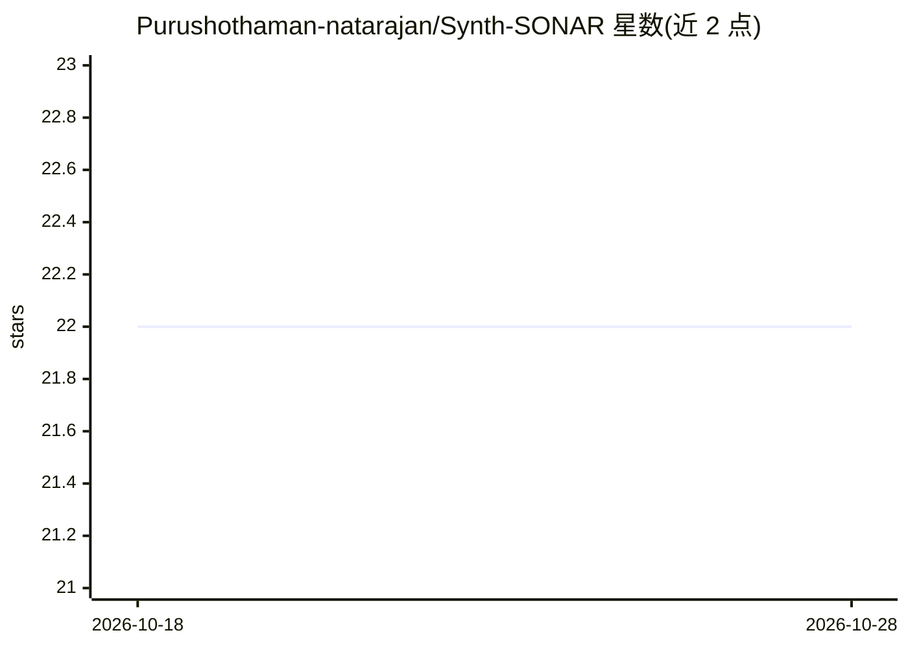

# Purushothaman-natarajan/Synth-SONAR

⭐ 22 · Python · MIT · 推送 2026-03-26 · [GitHub](https://github.com/Purushothaman-natarajan/Synth-SONAR) · [官网](https://www.arxiv.org/abs/2410.08612) · 个人维护

**声呐图像生成框架：双扩散模型+风格注入+GPT 提示合成图像**

面向声呐图像合成的研究框架，分三阶段运行：先汇集公开声呐图像、S3 仿真图与风格注入图像并生成低层描述；再用扩散模型生成粗粒度声呐图像并以文本变换器（LoRA）微调；最后由第二个扩散模型结合 VLM 增强的字幕输出细粒度图像。提供 Style Injection 运行脚本、标准与 LoRA 微调流程、GPT-3.5/LLaMA 字幕生成、PCA+K-Means 风格聚类等工具。需自行下载 Stable Diffusion v1-4 权重并配合 Hugging Face 生态训练。

## 筛选速览

| 维度 | 判定 | 备注 |
|---|---|---|
| AI 角色 | `ai-native` | 本体是模型或模型工具 |
| 许可风险 | `permissive` | MIT |
| 部署形态 | `library` | 以包/库形式分发 |
| 模型依赖 | — | README 未给出锁定关系 |
| 硬件要求 | — | 无带数字的原话,不猜 |
| 安装摩擦 | `low` | 无编译、无系统依赖或容器化 |
| 成熟度 | — | 结构信号不足 |

## 能力要点

- 双扩散模型三阶段流水线：粗粒度生成→细粒度精修
- Style Injection 风格注入提升生成多样性
- GPT-3.5 Turbo / LLaMA 生成低层与高层字幕
- 提供元数据生成与 PCA+K-Means 风格聚类工具脚本

## 适用场景

- 为声呐目标识别研究扩充训练图像数据集
- 按风格参考批量生成多样化声呐图像
- 对声呐图像做风格聚类以组织训练数据

## 场景标签

`图像生成` · 领域:内容生成

## 证据(README 行号)

> L9: **Synth-SONAR** is a sonar image generation framework that integrates **Style Injection** for diversity enhancement 
> L22:  - **Diffusion Model for Coarse Images**: The collected data and low-level + high-level descriptions are passed int
> L27:  - **Diffusion Model for Fine-Grained Images**: In this phase, a second diffusion model is applied to refine and ge

## 星数曲线

2026-10-18 22 → 2026-10-28 22（+0）

---
*卡片 v1 · prompt 1.4 · 生成 2026-10-27 · 置信度 mid · 依据 README sha `2b223818f8a6` · [字段定义](../../DATASET.md)*
