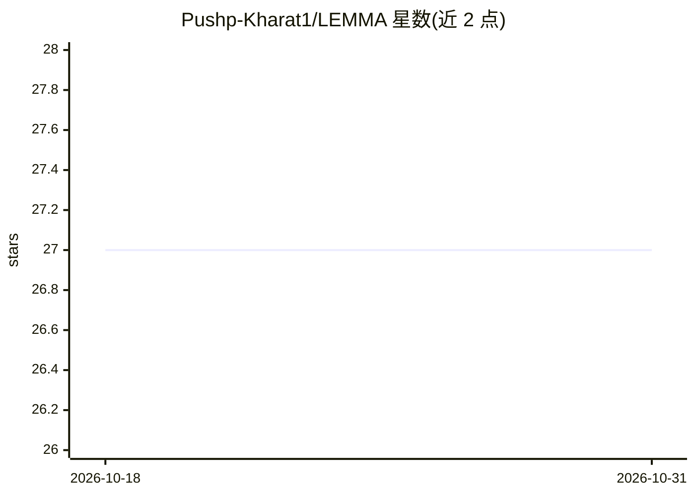

# Pushp-Kharat1/LEMMA

⭐ 27 · Rust · MPL-2.0 · 推送 2026-02-14 · [GitHub](https://github.com/Pushp-Kharat1/LEMMA) · 个人维护

**神经引导的符号数学推理研究原型（Rust）**

用 Rust 编写的神经符号数学研究原型：550+ 条经验证的数学变换规则覆盖算术、微积分、数论、不等式、组合等域，由 Transformer 策略网络（基于 Candle）引导的 MCTS/束搜索选择规则，验证器逐步核验并输出完整证明轨迹。自声明为研究代码而非生产可用、非完整 CAS、非 Wolfram Alpha 替代；早期基准结果因评估脚本问题已声明废弃。要求 Rust 1.75+，从源码构建，附带训练神经网络（约 17k 合成样本）的示例。

## 筛选速览

| 维度 | 判定 | 备注 |
|---|---|---|
| AI 角色 | `ai-native` | 本体是模型或模型工具 |
| 许可风险 | `permissive` | MPL-2.0 |
| 部署形态 | `None` |  |
| 模型依赖 | — | README 未给出锁定关系 |
| 硬件要求 | — | 无带数字的原话,不猜 |
| 安装摩擦 | `low` | 无编译、无系统依赖或容器化 |
| 成熟度 | `idea` | |

## 能力要点

- 550+ 条验证变换规则 + 神经策略网络引导的 MCTS 搜索
- 每步规则可证、验证器核验、输出完整证明轨迹
- 6 个 crate 分层结构（core/rules/verifier/search/brain/solver）
- 提供训练示例：生成约 17k 合成样本训练策略网络

## 适用场景

- 研究神经引导的符号推理与搜索控制机制
- 在基础微积分与代数变换任务上验证每步可证的推导
- 作为 AlphaProof 式数学搜索的学习与实验平台

## 场景标签

 · 领域:符号数学/神经符号 AI

## 证据(README 行号)

> L13: - A **research prototype** exploring hybrid neural-symbolic reasoning
> L16: - An **MCTS engine** guided by a neural policy network
> L63: 1. **Only applies verified mathematical rules** - no hallucination

## 星数曲线

2026-10-18 27 → 2026-10-31 27（+0）

---
*卡片 v1 · prompt 1.4 · 生成 2026-10-26 · 置信度 high · 依据 README sha `d36b19572843` · [字段定义](../../DATASET.md)*
