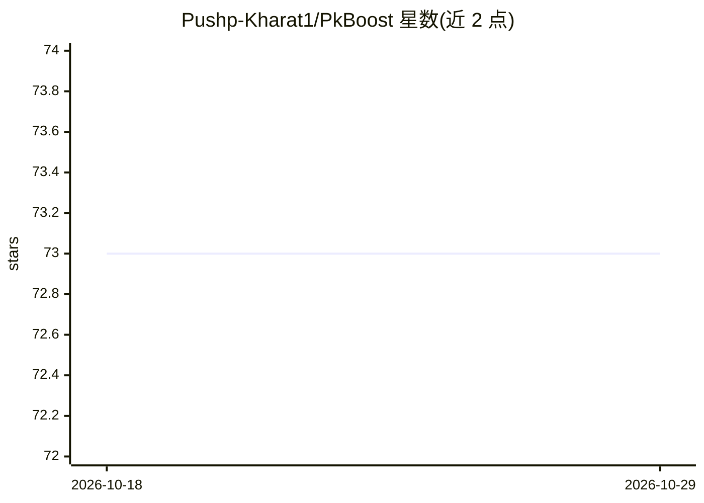

# Pushp-Kharat1/PkBoost

⭐ 73 · Rust · Apache-2.0 · 推送 2026-10-13 · [GitHub](https://github.com/Pushp-Kharat1/PkBoost) · [官网](https://pkboost.vercel.app/) · 个人维护

**Rust 实现的自适应梯度提升库，处理极度不平衡与概念漂移下的分类**

PKBoost（Performance-Based Knowledge Booster）是从零用 Rust 实现的梯度提升决策树库，针对少数类占比极低（如 0.2% 欺诈率）的二元/多类分类、回归及数据漂移场景。核心机制：Shannon 熵引导的分裂准则（Gain = GradientGain + λ·InformationGain）、自动类别加权、PR-AUC 早停、auto_tune_principled 数据集感知调参，以及实验性的 AdversarialLivingBooster 漂移监测与再训练。提供 PyPI 包与 cargo 源码构建两种途径，内置 PR-AUC/ROC-AUC/F1 指标与基准复现脚本。限制：不小于 1,000 样本、不支持类别特征（需先编码）、自适应再训练为实验性。

## 筛选速览

| 维度 | 判定 | 备注 |
|---|---|---|
| AI 角色 | `ai-native` | 本体是模型或模型工具 |
| 许可风险 | `permissive` | Apache-2.0 |
| 部署形态 | `library` | 以包/库形式分发 |
| 模型依赖 | — | README 未给出锁定关系 |
| 硬件要求 | — | 无带数字的原话,不猜 |
| 安装摩擦 | `medium` | 含编译或系统依赖之一 |
| 成熟度 | `idea` | |

## 能力要点

- Shannon 熵正则化的分裂准则，按不平衡度自适应加权
- auto_tune_principled 数据集画像自动调参，无需手工调优
- AdversarialLivingBooster 通过脆弱性分数监测漂移并触发选择性再训练
- One-vs-Rest + softmax 多类分类、Rayon 硬件感知并行

## 适用场景

- 在少数类占比极低的欺诈检测中直接训练分类模型
- 数据分布随时间漂移的场景下做分类并保持少数类召回
- 不想手动调超参、希望开箱即用的不平衡分类任务

## 场景标签

 · 领域:机器学习/表格数据分类

## 证据(README 行号)

> L12: Built from scratch in Rust, PKBoost (Performance-Based Knowledge Booster) manages changing data distributions in fr
> L214: - **Shannon entropy guidance** optimizes splits for information gain on the minority class.
> L229: [Your Data] → [Auto-Tuner] → [Shannon-Guided Trees] → [Predictions]

## 星数曲线

2026-10-18 73 → 2026-10-29 73（+0）

---
*卡片 v1 · prompt 1.4 · 生成 2026-10-24 · 置信度 high · 依据 README sha `4298b4fd701b` · [字段定义](../../DATASET.md)*
