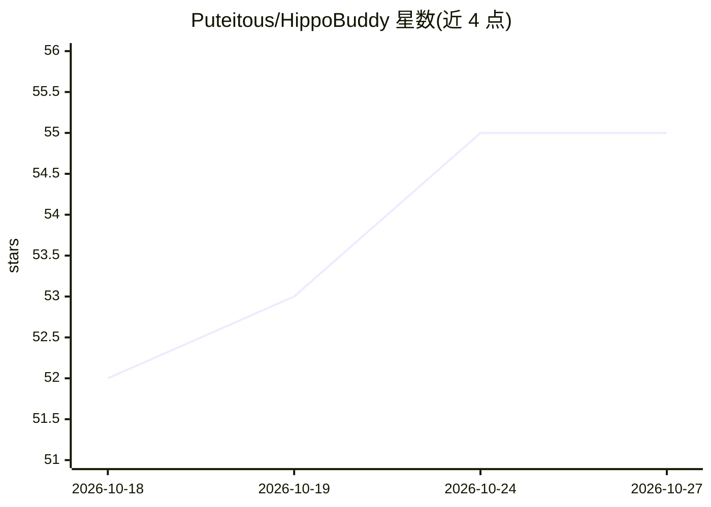

# Puteitous/HippoBuddy

⭐ 55 · Java · Apache-2.0 · 推送 2026-10-07 · [GitHub](https://github.com/Puteitous/HippoBuddy) · [官网](https://www.hippobuddy.cn/) · 个人维护 · 中文 README

**桌面 AI 助手：聊天、AI 编程与 Office 办公一体**

基于 Electron 35 + Java 21 的开源桌面应用，提供聊天/代码/办公三种模式：理解项目上下文生成、修改、重构代码，读写编辑文件并支持 diff 预览与回滚，内置 Word/Excel/PPT/CSV 解析与生成。具备子代理并行协作、会话记忆提取与检索、MCP 双通道客户端（SSE/Stdio）、Skill 技能系统与 16+ 内置工具。需用户自行配置 LLM API 密钥，支持 DeepSeek/Claude/GPT/Ollama。提供 Windows/macOS/Linux 安装包，亦可源码构建。

## 筛选速览

| 维度 | 判定 | 备注 |
|---|---|---|
| AI 角色 | `ai-native` | 本体是模型或模型工具 |
| 许可风险 | `permissive` | Apache-2.0 |
| 部署形态 | `desktop` | 安装包/桌面程序 |
| 模型依赖 | local-ok | 支持本地模型 |
| 硬件要求 | — | 无带数字的原话,不猜 |
| 安装摩擦 | `medium` | 含编译或系统依赖之一 |
| 成熟度 | — | 结构信号不足 |

## 能力要点

- 聊天/代码/办公三模式，AI 编程支持 diff 预览与回滚
- 内置 Word/Excel/PPT/CSV 解析与生成
- 子代理体系、智能记忆、MCP 动态扩展与 Skill 技能系统
- 16+ 内置工具与实时 Token/LLM 监控

## 适用场景

- 在桌面端通过对话完成代码生成、修改与重构
- 让 AI 读写和生成 Office 文档
- 通过 MCP 与技能库扩展 AI 助手能力

## 场景标签

`AI 助手` `聊天机器人` `编码 Agent` · 领域:编码与开发

## 证据(README 行号)

> L4:  AI-powered desktop assistant for chat, coding, and office productivity.
> L40: |**智能对话**|聊天 / 代码 / 办公三种模式，自由切换|
> L41: |**AI 编程协助**|理解项目上下文，生成、修改、重构代码|

## 星数曲线

2026-10-18 52 → 2026-10-27 55（+3）

---
*卡片 v1 · prompt 1.4 · 生成 2026-10-24 · 置信度 high · 依据 README sha `fd8d1d153940` · [字段定义](../../DATASET.md)*
