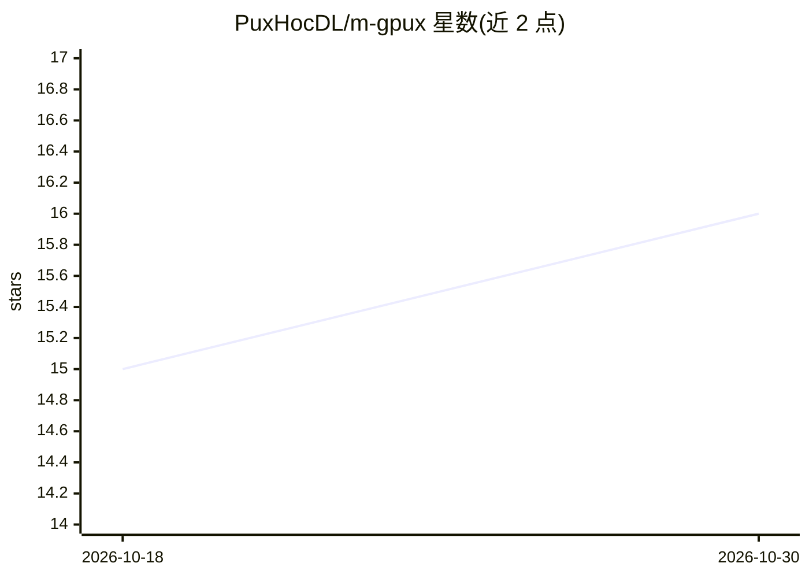

# PuxHocDL/m-gpux

⭐ 16 · Python · MIT · 推送 2026-10-21 · [GitHub](https://github.com/PuxHocDL/m-gpux) · [官网](https://puxhocdl.github.io/m-gpux/) · 个人维护

**Modal GPU 云的 CLI 工作台：开发盒/Jupyter/托管/LLM 服务/计费管理**

基于 pip 安装的 Python CLI，封装 Modal 的 Sandboxes/Functions/Servers/Volumes 等原语，将本地文件夹变为远程 GPU 开发盒（SSH/VS Code Remote-SSH、pause 快照与 resume）、Jupyter 会话、FastAPI/Flask/Django/静态站点托管，以及用 vLLM 将任意 Hugging Face 模型部署为 OpenAI 兼容端点；另支持整个 docker-compose.yml 的三种方式上云。面向持有多个 Modal 账号的开发者，提供按账号的月度预算上限、GPU 价格显示与自动账号选择；每个工作流生成可读可改的 Modal 脚本。配套 VS Code 扩展与示例工程。

## 筛选速览

| 维度 | 判定 | 备注 |
|---|---|---|
| AI 角色 | `ai-ecosystem` | LLM/agent 周边工具 |
| 许可风险 | `permissive` | MIT |
| 部署形态 | `self-host` | docker 或自建部署 |
| 模型依赖 | local-ok | 支持本地模型 |
| 硬件要求 | — | 无带数字的原话,不猜 |
| 安装摩擦 | `low` | 无编译、无系统依赖或容器化 |
| 成熟度 | — | 结构信号不足 |

## 能力要点

- 将本地文件夹变为 Modal GPU 开发盒（SSH/VS Code、pause/resume、双向 sync）
- serve deploy 用 vLLM 把 Hugging Face 模型部署为 OpenAI 兼容端点（API key/流式/监控面板）
- 多账号管理与每账号月度预算上限、GPU $/小时价格展示（T4 至 B300、多 GPU 容器）
- docker-compose.yml 可整体上云：单容器、VM 镜像或每服务一个 Sandbox

## 适用场景

- 在远程 GPU 上搭建可暂停快照的开发环境并用 SSH/VS Code 接入
- 把自己的模型部署成 OpenAI 兼容 API 端点
- 管理多个 Modal 账号的花费预算并按价格挑选 GPU
- 把现有 docker-compose 项目迁移到 Modal GPU 上运行

## 场景标签

`推理引擎` · 领域:训练与推理

## 证据(README 行号)

> L13: m-gpux is a CLI for getting real work done on Modal GPUs. It turns a folder on your laptop into a GPU dev box, a Ju
> L50: m-gpux wraps Modal's primitives (Sandboxes, Functions, Servers, Volumes, named Images) into workflows that fit how 
> L56: - **Your own OpenAI-compatible endpoint** — `m-gpux serve deploy` puts any Hugging Face model behind vLLM with API 

## 星数曲线

2026-10-18 15 → 2026-10-30 16（+1）

---
*卡片 v1 · prompt 1.4 · 生成 2026-10-30 · 置信度 mid · 依据 README sha `b27ad0a67f6e` · [字段定义](../../DATASET.md)*
