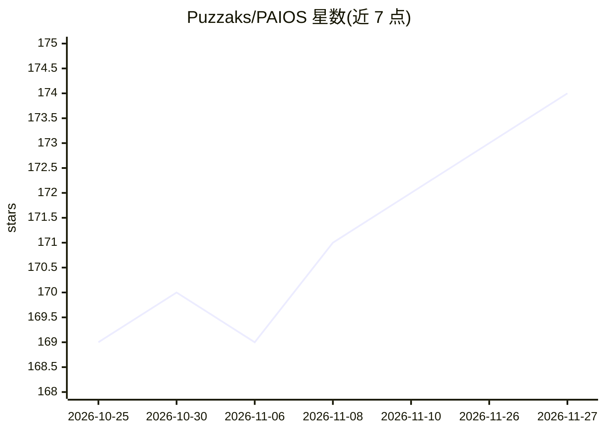

# Puzzaks/PAIOS

⭐ 174 · Dart · Unlicense · 推送 2026-11-20 · [GitHub](https://github.com/Puzzaks/PAIOS) · [官网](https://puzzak.page) · 个人维护

**离线运行 Gemini Nano 的 Android 端私人 AI 助手应用**

面向 Android 用户的端侧 AI 界面应用：通过 Google AI Core / ML Kit GenAI Prompt API 在设备上运行 Gemini Nano，推理全程离线，提示词、对话与附件留在手机本地，在线扩展默认关闭。提供多模型管理（Stable/Preview 通道）、思考模式、可作为系统数字助理并读取屏幕上下文，支持图片输入、RAG 与最多 6 轮的工具链调用。限制方面依赖特定芯片与 8GB+ RAM，端侧输出有 256 token 上限，通过自动续写缓解。安装途径为 Google Play 与 GitHub Releases。

## 筛选速览

| 维度 | 判定 | 备注 |
|---|---|---|
| AI 角色 | `ai-native` | 本体是模型或模型工具 |
| 许可风险 | `permissive` | Unlicense |
| 部署形态 | `None` |  |
| 模型依赖 | — | README 未给出锁定关系 |
| 硬件要求 | — | 无带数字的原话,不猜 |
| 安装摩擦 | `low` | 无编译、无系统依赖或容器化 |
| 成熟度 | — | 结构信号不足 |

## 能力要点

- 端侧离线推理，对话与附件不上传（在线扩展默认关闭）
- 多模型管理器：Stable/Preview 通道切换与思考模式
- 可设为 Android 数字助理并读取屏幕上下文
- 工具调用模块与 RAG，附带 23 页离线 GenAI 文档浏览器

## 适用场景

- 在不联网的手机上使用 AI 对话与文档问答
- 把 Gemini Nano 设为系统助理并读取屏幕上下文
- 拍照或相册图片的端侧识别描述

## 场景标签

`AI 助手` `文档问答` `RAG` · 领域:对话与助手

## 证据(README 行号)

> L26: - **100% Offline & Private by design**: Inference runs on-device with Gemini nano (`Google AI Core`). Prompts, chat
> L48: Google AI Core / ML Kit GenAI Prompt API is now in **Beta**, powering `gemini-nano-v3` (Stable) and `gemini-nano-v4

## 星数曲线

2026-10-25 169 → 2026-11-27 174（+5）

---
*卡片 v1 · prompt 1.4 · 生成 2026-11-26 · 置信度 high · 依据 README sha `e0d8a5b74902` · [字段定义](../../DATASET.md)*
