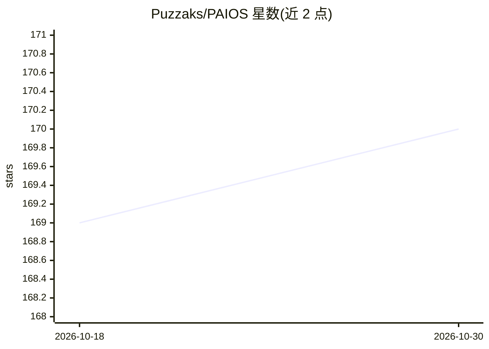

# Puzzaks/PAIOS

⭐ 170 · Dart · Unlicense · 推送 2026-05-17 · [GitHub](https://github.com/Puzzaks/PAIOS) · [官网](https://puzzak.page) · 个人维护

**Android 上离线运行 Gemini Nano 的本地聊天客户端**

面向终端用户的个人 AI 操作界面：作为 Google AI Core 中 Gemini Nano 模型的客户端，在支持设备（如 Pixel 9/10 系列）上完全离线运行对话，数据不出手机。功能包括多会话管理（创建/重命名/置顶）、温度与最大响应 token 调节、[USER INSTRUCTIONS] 自定义指令、可选注入时间/语言上下文、可查看实际 System Prompt。处于 Alpha 状态，模型为开发者预览版，推理与知识深度不及云端大模型，可能产生幻觉或丢失上下文；输入某些词汇可能因内部过滤器导致应用软锁。通过 Google Play 与 GitHub Releases 分发。

## 筛选速览

| 维度 | 判定 | 备注 |
|---|---|---|
| AI 角色 | `ai-native` | 本体是模型或模型工具 |
| 许可风险 | `permissive` | Unlicense |
| 部署形态 | `None` |  |
| 模型依赖 | — | README 未给出锁定关系 |
| 硬件要求 | — | 无带数字的原话,不猜 |
| 安装摩擦 | `low` | 无编译、无系统依赖或容器化 |
| 成熟度 | `idea` | |

## 能力要点

- 基于 Google AI Core 的 Gemini Nano，100% 设备内离线运行
- 多会话管理、温度/最大 token 调节、自定义指令
- 可查看实际使用的 System Prompt
- 可选注入当前时间/日期与语言上下文

## 适用场景

- 在手机上离线进行私密 AI 对话，不联网不上传数据
- 用自定义指令让本地模型扮演特定角色或执行任务
- 在无网络环境下使用摘要、智能回复等端侧模型能力

## 场景标签

`聊天机器人` `AI 助手` · 领域:对话与助手

## 证据(README 行号)

> L28:  - **100% Offline & Private**: Runs entirely on-device using Google's AI Core. No data leaves your phone.
> L36: PAIOS acts as a client for the underlying Gemini Nano model, which is a developer preview.

## 星数曲线

2026-10-18 169 → 2026-10-30 170（+1）

---
*卡片 v1 · prompt 1.4 · 生成 2026-10-22 · 置信度 high · 依据 README sha `68be0f78725d` · [字段定义](../../DATASET.md)*
