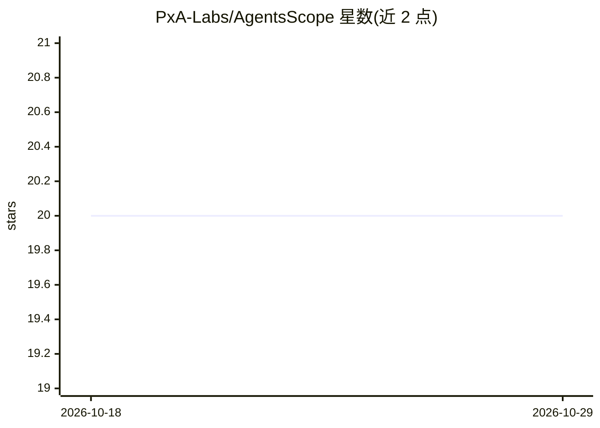

# PxA-Labs/AgentsScope

⭐ 20 · Python · Apache-2.0 · 推送 2026-10-26 · [GitHub](https://github.com/PxA-Labs/AgentsScope) · 组织维护

**自托管多智能体 AI 管线的可观测性仪表盘**

面向多智能体 AI 管线开发者的开源自托管可观测性工具：在 Python 代码中加入两行回调（AgentScopeCallback），即可在本地仪表盘查看实时事件流、Agent 调用 DAG 图、token 用量与成本估算、事件详情与历史会话。架构为 Python SDK 经 WebSocket 连接 FastAPI 服务端（SQLite 默认/可选 PostgreSQL），Next.js 前端展示。通过 docker compose 一键启动；官方声明主要面向本地开发调试，非生产环境工具；当前集成 LangChain 0.2+，CrewAI 支持在路线图中。

## 筛选速览

| 维度 | 判定 | 备注 |
|---|---|---|
| AI 角色 | `ai-ecosystem` | LLM/agent 周边工具 |
| 许可风险 | `permissive` | Apache-2.0 |
| 部署形态 | `self-host` | docker 或自建部署 |
| 模型依赖 | — | README 未给出锁定关系 |
| 硬件要求 | — | 无带数字的原话,不猜 |
| 安装摩擦 | `low` | 无编译、无系统依赖或容器化 |
| 成熟度 | `idea` | |

## 能力要点

- 两行代码接入，实时事件流与 Agent DAG 可视化
- token 用量统计、成本估算与延迟热力图
- 自托管，数据存于本地 SQLite（可选 PostgreSQL），无云依赖
- SDK 采用 fire-and-forget 后台任务，不阻塞 agent 管线

## 适用场景

- 调试多智能体管线时替代 verbose 日志查看运行过程
- 追踪 agent 管线的 token 消耗与成本
- 回放并对比历史会话的运行结果

## 场景标签

`LLM 可观测性` `多智能体` · 领域:Agent 开发

## 证据(README 行号)

> L30: **AgentScope** is a lightweight, open-source, self-hosted observability dashboard designed specifically for multi-a
> L62: - **LangChain Integration** — Works with LangChain 0.2+ out of the box

## 星数曲线

2026-10-18 20 → 2026-10-29 20（+0）

---
*卡片 v1 · prompt 1.4 · 生成 2026-10-28 · 置信度 mid · 依据 README sha `d8588943132b` · [字段定义](../../DATASET.md)*
