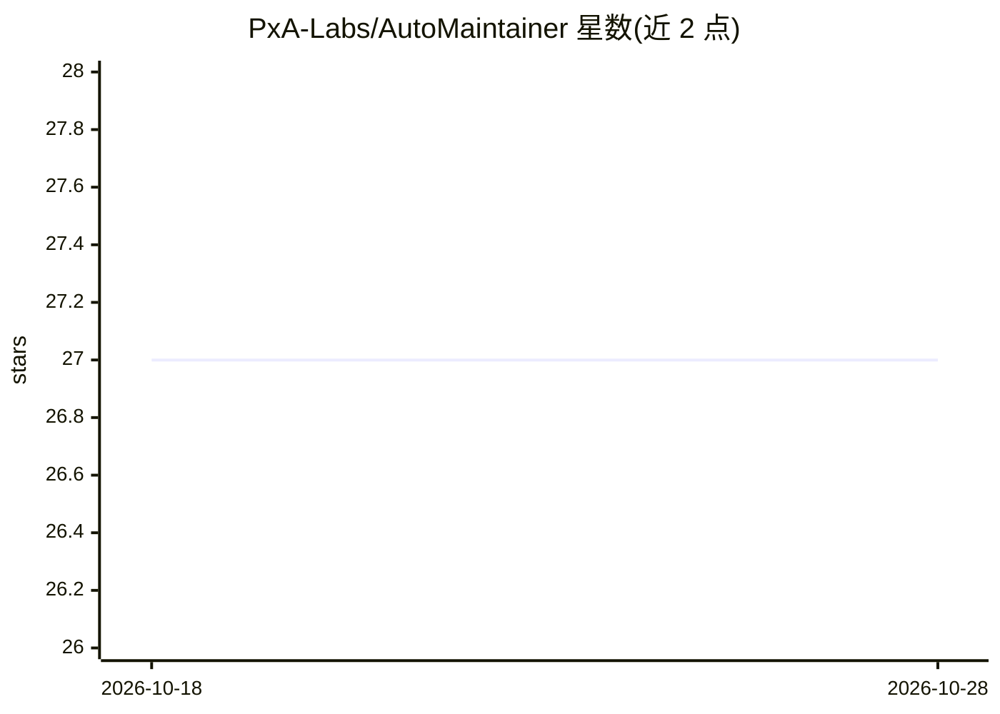

# PxA-Labs/AutoMaintainer

⭐ 27 · Python · MIT · 推送 2026-10-24 · [GitHub](https://github.com/PxA-Labs/AutoMaintainer) · [官网](https://auto-maintainer.vercel.app) · 组织维护

**在 GitHub 仓库内自主运行的 AI 软件工程多智能体平台**

基于 LangGraph、FastAPI 与 Next.js 构建的多智能体自主软件工程平台，由 Llama 3（经 Groq LPU 推理）驱动 5 个专职 Agent（Architect/Visionary/Reviewer/Implementer/Maintainer），通过 GitHub Issues、PR 评论与分支协作，完成发现问题、设计架构、实现代码变更、开 PR、审查 diff、自我纠错与合并。代码智能由 GitNexus MCP 本地完成，不向第三方服务器发送代码；依赖 Supabase 做遥测与实时日志流。当前正从本地原型向 Web-First SaaS 架构迁移，README 明示系统不稳定，自部署需自行准备 Supabase 项目与 Groq/GitHub 凭据。

## 筛选速览

| 维度 | 判定 | 备注 |
|---|---|---|
| AI 角色 | `ai-native` | 本体是模型或模型工具 |
| 许可风险 | `permissive` | MIT |
| 部署形态 | `self-host` | docker 或自建部署 |
| 模型依赖 | locked-api |  |
| 硬件要求 | — | 无带数字的原话,不猜 |
| 安装摩擦 | `low` | 无编译、无系统依赖或容器化 |
| 成熟度 | `idea` | |

## 能力要点

- 5-Agent 层级协作：架构、实现、审查、维护分工并通过真实 GitHub 对象通信
- GitNexus MCP 提供零服务器代码智能，本地构建 Code Graph
- 自我纠错循环：PR 被拒后 Implementer 读取反馈推送修复提交
- 提供 Vercel/Render 部署配置与 GHCR 多架构 Docker 镜像

## 适用场景

- 让 AI 团队在自己仓库内自动处理 Issue 并提交 PR
- 实时观测多个 Agent 的工作过程与日志流
- 通过浏览器内 Web IDE 与交互终端检查 diff 并进行在线协助

## 场景标签

`多智能体` `编码 Agent` · 领域:Agent 开发

## 证据(README 行号)

> L17: AutoMaintainer is an autonomous, multi-agent AI software engineering platform operating natively inside your GitHub
> L19: Built with **LangGraph**, **FastAPI**, **Next.js**, and powered by **Llama 3 (via Groq)**, the system coordinates s
> L47: - **5-Agent Hierarchy**: Tasks are distributed across specialized agents (Architect, Visionary, Reviewer, Implement

## 星数曲线

2026-10-18 27 → 2026-10-28 27（+0）

---
*卡片 v1 · prompt 1.4 · 生成 2026-10-26 · 置信度 high · 依据 README sha `4a9d87fba1a1` · [字段定义](../../DATASET.md)*
