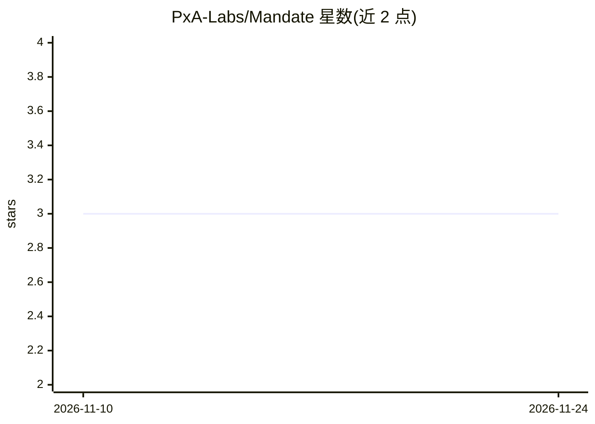

# PxA-Labs/Mandate

⭐ 3 · TypeScript · Apache-2.0 · 推送 2026-11-23 · [GitHub](https://github.com/PxA-Labs/Mandate) · [官网](https://mandate-web-vo77.onrender.com) · 组织维护

**给 AI agent 消费加预算护栏：LLM 提议，代码裁决**

Mandate 是 AI agent 支出的护栏系统：财务人员设定总预算、单品上限、品类与人工审批阈值，LLM 仅解析意图并返回候选商品 ID 与数量，随后由不含 LLM 与 I/O 的确定性 TypeScript 策略引擎重算价格并给出 ALLOW/NEEDS_APPROVAL/DENY，支付经 PayPal Orders v2 sandbox 完成，人工审批走 Zapier，全部决策写入 append-only 审计日志并在 AG Grid 仪表盘展示。含针对 naive 与 prompt-hardened agent 的攻击基准评测框架。目标用户假设为学生社团财务与小团队运营（README 标注为未验证假设）；仅支持 sandbox，无真实资金流动。

## 筛选速览

| 维度 | 判定 | 备注 |
|---|---|---|
| AI 角色 | `ai-ecosystem` | LLM/agent 周边工具 |
| 许可风险 | `permissive` | Apache-2.0 |
| 部署形态 | `self-host` | docker 或自建部署 |
| 模型依赖 | — | README 未给出锁定关系 |
| 硬件要求 | — | 无带数字的原话,不猜 |
| 安装摩擦 | `low` | 无编译、无系统依赖或容器化 |
| 成熟度 | `idea` | |

## 能力要点

- LLM 只提议（无工具无凭证），确定性策略引擎裁决支付
- 预算、单品上限、品类、审批阈值与拆单/价格漂移检测
- Zapier 人工审批流程与 append-only 审计日志仪表盘
- 同一攻击套件对 naive/prompt-hardened/Mandate 三种配置的基准

## 适用场景

- 让 AI agent 代为采购时限制总预算与单品金额
- 超过阈值的大额采购转人工审批后再支付
- 事后审计 agent 的每笔被拦截或放行的购买决策

## 场景标签

`模型评测` `网络安全` · 领域:评测与运维

## 证据(README 行号)

> L40: **Spending guardrails for AI agents.** A team sets the rules; an AI agent shops inside them; deterministic code — n
> L77: 4. **Code decides.** A deterministic policy engine (pure TypeScript, no LLM, no I/O) recomputes every price from no
> L148: |LLM|`mistralai/mistral-large-4-1t-a52b` on NVIDIA's API catalog (OpenAI-compatible), no tools, strict JSON-schema

## 星数曲线

2026-11-10 3 → 2026-11-24 3（+0）

---
*卡片 v1 · prompt 1.4 · 生成 2026-11-22 · 置信度 mid · 依据 README sha `ac3b95aa81d1` · [字段定义](../../DATASET.md)*
