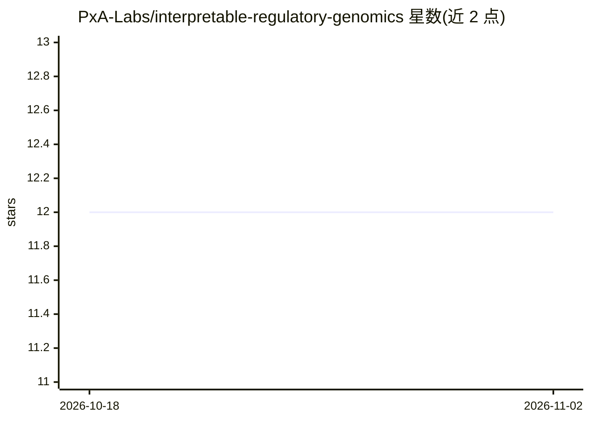

# PxA-Labs/interpretable-regulatory-genomics

⭐ 12 · Jupyter Notebook · MIT · 推送 2026-09-21 · [GitHub](https://github.com/PxA-Labs/interpretable-regulatory-genomics) · 组织维护

**用可解释 ML 从 ENCODE 数据识别非编码 DNA 调控开关**

面向基因组学研究的可解释机器学习项目：以 ENCODE 注释的候选顺式调控元件（cCREs）为输入，区分活跃调控区与非调控非编码 DNA。研究路线分三阶段：经典基线（XGBoost/k-mer + SHAP）、CNN（显著性图/积分梯度）、Nucleotide Transformer 500M 预训练嵌入，Phase 3 最佳 Test AUROC 0.9176。以 Jupyter notebook 形式提供，设计运行于 Kaggle T4 GPU，也可本地运行。含 12 份 PDF 项目文档与 pytest 测试。限制：跨细胞类型泛化与文档交付仍在进行中。

## 筛选速览

| 维度 | 判定 | 备注 |
|---|---|---|
| AI 角色 | `ai-native` | 本体是模型或模型工具 |
| 许可风险 | `permissive` | MIT |
| 部署形态 | `library` | 以包/库形式分发 |
| 模型依赖 | — | README 未给出锁定关系 |
| 硬件要求 | — | 无带数字的原话,不猜 |
| 安装摩擦 | `low` | 无编译、无系统依赖或容器化 |
| 成熟度 | — | 结构信号不足 |

## 能力要点

- 三阶段建模路线：经典基线/CNN/Nucleotide Transformer 嵌入
- SHAP、显著性图、积分梯度等可解释性分析
- Phase 3 最佳模型 Test AUROC 0.9176
- 面向 Kaggle T4 GPU 的受限算力与可复现性设计

## 适用场景

- 我要研究非编码 DNA 中的序列级调控开关模式
- 在 T4 级别的受限算力上复现基因组调控区分类实验
- 比较经典基线与预训练基因组模型的跨细胞类型泛化表现

## 场景标签

 · 领域:生物信息学/基因组调控

## 证据(README 行号)

> L5: This project applies interpretable machine learning to ENCODE-annotated candidate cis-regulatory elements (cCREs) to
> L40: |phase2_deep_learning.ipynb|Phase 2|CNN training, convolutional filter analysis, saliency maps, and integrated grad
> L53: |**Phase 3**|Pre-trained Foundation Models|Nucleotide Transformer (500M)|0.9176|Complete|

## 星数曲线

2026-10-18 12 → 2026-11-02 12（+0）

---
*卡片 v1 · prompt 1.4 · 生成 2026-11-01 · 置信度 mid · 依据 README sha `9d92582ea60e` · [字段定义](../../DATASET.md)*
