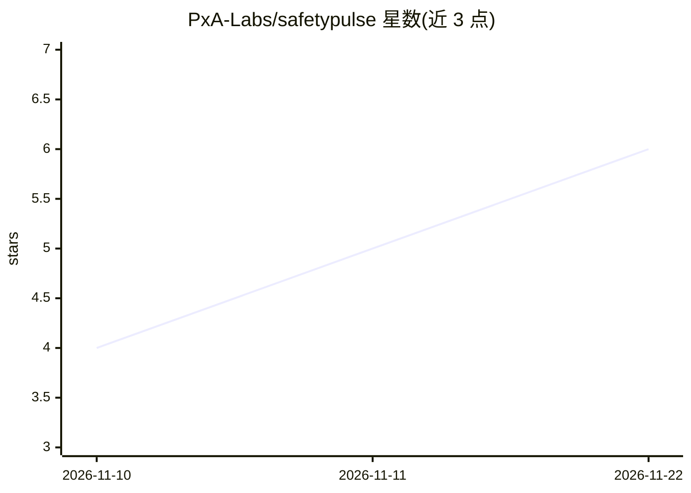

# PxA-Labs/safetypulse

⭐ 6 · Jupyter Notebook · Apache-2.0 · 推送 2026-11-21 · [GitHub](https://github.com/PxA-Labs/safetypulse) · [官网](https://huggingface.co/blog/purvansh01/safetypulse-safety-drift-monitor) · 组织维护

**LLM 微调安全漂移的早期预警与修复审计工具包**

面向 LLM 微调流程的安全回归门禁：从模型内部拒绝机制读出 Circuit Integrity Score（CIS），用 50 组提示对在每个 checkpoint 上快速判级 PASS/WARN/FAIL，在不做完整红队审计的前提下提前发现拒绝能力弱化。FAIL 时通过 SafeTune 做安全向量修复，再用 AuditKIT 做配对前后审计；另有 CircuitKIT 对拒绝回路做独立交叉验证。提供 HF Trainer 回调集成与预校准 probe bundle，实验全在 Kaggle T4 上以 notebook 复现。

## 筛选速览

| 维度 | 判定 | 备注 |
|---|---|---|
| AI 角色 | `ai-ecosystem` | LLM/agent 周边工具 |
| 许可风险 | `permissive` | Apache-2.0 |
| 部署形态 | `library` | 以包/库形式分发 |
| 模型依赖 | — | README 未给出锁定关系 |
| 硬件要求 | — | 无带数字的原话,不猜 |
| 安装摩擦 | `low` | 无编译、无系统依赖或容器化 |
| 成熟度 | — | 结构信号不足 |

## 能力要点

- CIS 早期预警：在 ASR 上升前 1-3 个 checkpoint 触发告警（每检查约 55 GPU-s）
- SafeTune 修复：ASR 25.2%→12.3%，GSM8K 55.1%→70.7%
- HF Trainer 回调集成，可自动检查每个保存的 checkpoint
- safetypulse calibrate 可为新基座模型从对比对构建 bundle

## 适用场景

- 微调对齐模型时在每个 checkpoint 上做安全漂移筛查
- 发现拒绝能力退化后执行 SafeTune 修复并做前后审计
- 为新基座模型校准拒绝方向与阈值 bundle

## 场景标签

`微调` `模型评测` · 领域:评测与运维

## 证据(README 行号)

> L38: SafetyPulse works as a **safety regression gate** for fine-tuning, the way a test suite gates a code change: it
> L111: trainer.add_callback(SafetyPulseCallback("bundle", on_fail="stop"))   # checks every saved checkpoint

## 星数曲线

2026-11-10 4 → 2026-11-22 6（+2）

---
*卡片 v1 · prompt 1.4 · 生成 2026-11-21 · 置信度 high · 依据 README sha `99e0f0c601e5` · [字段定义](../../DATASET.md)*
