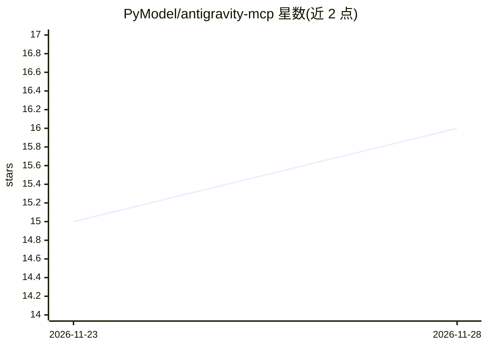

# PyModel/antigravity-mcp

⭐ 16 · TypeScript · MIT · 推送 2026-11-27 · [GitHub](https://github.com/PyModel/antigravity-mcp) · [官网](https://github.com/PyModel/antigravity-mcp#install) · 个人维护

**把编码代理客户端经 Antigravity CLI 接入 Gemini 模型的 MCP 桥接服务器**

一个本地 MCP stdio 服务器，作为 Pi、OpenCode、Codex、Claude Code 等编码代理客户端与 Antigravity CLI（agy）认证会话之间的桥接。宿主保留自身模型与工作流，可将研究、代码评审、实现等任务委托给账户清单内的模型（如 Gemini 4 系列）。机制包括：模型 ID 解析、会话保持与 follow_up 续聊、用量上报、有界输出（AGY_MAX_OUTPUT_CHARS 限制）。限制：需 macOS/Linux、Node.js、已认证的 agy；模型可用性随账户订阅变动。

## 筛选速览

| 维度 | 判定 | 备注 |
|---|---|---|
| AI 角色 | `ai-ecosystem` | LLM/agent 周边工具 |
| 许可风险 | `permissive` | MIT |
| 部署形态 | `library` | 以包/库形式分发 |
| 模型依赖 | — | README 未给出锁定关系 |
| 硬件要求 | — | 无带数字的原话,不猜 |
| 安装摩擦 | `low` | 无编译、无系统依赖或容器化 |
| 成熟度 | — | 结构信号不足 |

## 能力要点

- 通过本地 MCP stdio 服务器将四类编码代理客户端接入 Antigravity 模型
- 模型路由：按 agy models 实时清单解析模型 ID，set_model 切换偏好
- 可恢复会话：follow_up 在同一 AGY 会话中继续追问或修正
- 上报用量与部分失败诊断，输出受 AGY_MAX_OUTPUT_CHARS 上限约束

## 适用场景

- 让 Claude Code 或 Codex 把深度研究、代码评审任务委托给 Gemini 模型
- 在宿主代理保留原有工作流的同时按订阅计划选用不同模型档位
- 跨长任务维持 AGY 会话，后续追问不重建上下文

## 场景标签

`模型网关` · 领域:Agent 开发

## 证据(README 行号)

> L18: **Connect your coding agent to Antigravity models for research, code review, and implementation.** Use Pi, OpenCode
> L22: **Package:** `@pymodel/antigravity-mcp@1.0.0`. Install from npm or use the source build. Existing users should read

## 星数曲线

2026-11-23 15 → 2026-11-28 16（+1）

---
*卡片 v1 · prompt 1.4 · 生成 2026-11-23 · 置信度 high · 依据 README sha `46a47dc72d3a` · [字段定义](../../DATASET.md)*
