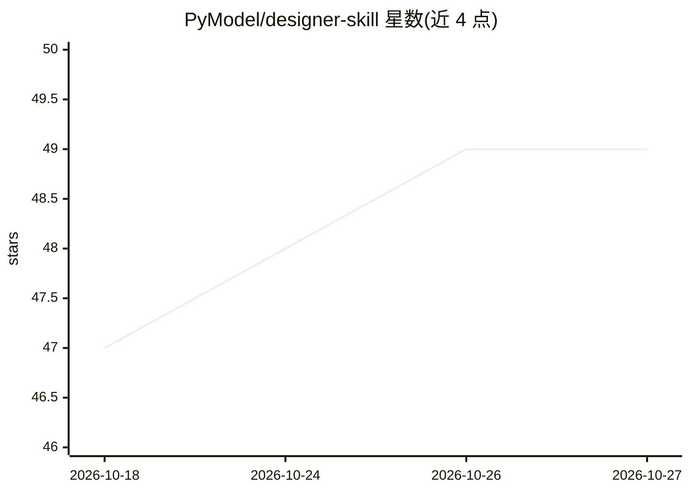

# PyModel/designer-skill

⭐ 49 · JavaScript · MIT · 推送 2026-10-25 · [GitHub](https://github.com/PyModel/designer-skill) · [官网](https://niblet.pymodel.com/) · 组织维护

**给编码 agent 加 UI 设计能力的 MCP 技能服务器**

面向 Claude Code、Codex、Cursor 等 MCP 客户端的 UI 设计技能与工具服务器：以 SKILL.md 形式提供 24 个设计参考与 26 个 UX 参考，工具覆盖意图路由（dispatch_intent 将口语化请求映射为设计动词与参考）、参考加载、44 条规则的确定性静态检测与 review_and_gate 静态门（只输出 FAIL 或 NOT_VERIFIED，不宣称渲染就绪）。可选对接 Niblet 平台获取真实屏幕参考与素材。经 npm 分发，需 Node 22+，支持 stdio 与 HTTP 两种运行模式。

## 筛选速览

| 维度 | 判定 | 备注 |
|---|---|---|
| AI 角色 | `ai-ecosystem` | LLM/agent 周边工具 |
| 许可风险 | `permissive` | MIT |
| 部署形态 | `library` | 以包/库形式分发 |
| 模型依赖 | — | README 未给出锁定关系 |
| 硬件要求 | — | 无带数字的原话,不猜 |
| 安装摩擦 | `low` | 无编译、无系统依赖或容器化 |
| 成熟度 | — | 结构信号不足 |

## 能力要点

- SKILL.md 技能 + MCP 工具：意图路由、参考加载、设计动词命令
- 44 条规则的确定性静态检测器与 review_and_gate 静态门
- 24 个设计参考与 26 个 ux/* 参考，按需加载
- 一键安装到 Claude Code / Codex / Cursor / VS Code 等客户端

## 适用场景

- 给编码 agent 添加 UI 设计指导与静态审查能力
- 重构或重设计页面时获得意图路由与参考文档
- 在提交前对设计改动跑确定性静态检查

## 场景标签

`编码 Agent` · 领域:编码与开发

## 证据(README 行号)

> L3: **Plug-and-play MCP. UI superpowers for your agent.**
> L23: **Paste into your agent** (Claude Code, Codex, Cursor, any MCP client). It installs the skill, wires the MCP and ve
> L47: { "mcpServers": { "designer-skill": { "command": "npx", "args": ["-y", "@pymodel/designer-skill-mcp@latest"] } } }

## 星数曲线

2026-10-18 47 → 2026-10-27 49（+2）

---
*卡片 v1 · prompt 1.4 · 生成 2026-10-25 · 置信度 high · 依据 README sha `1c7a7b77767e` · [字段定义](../../DATASET.md)*
