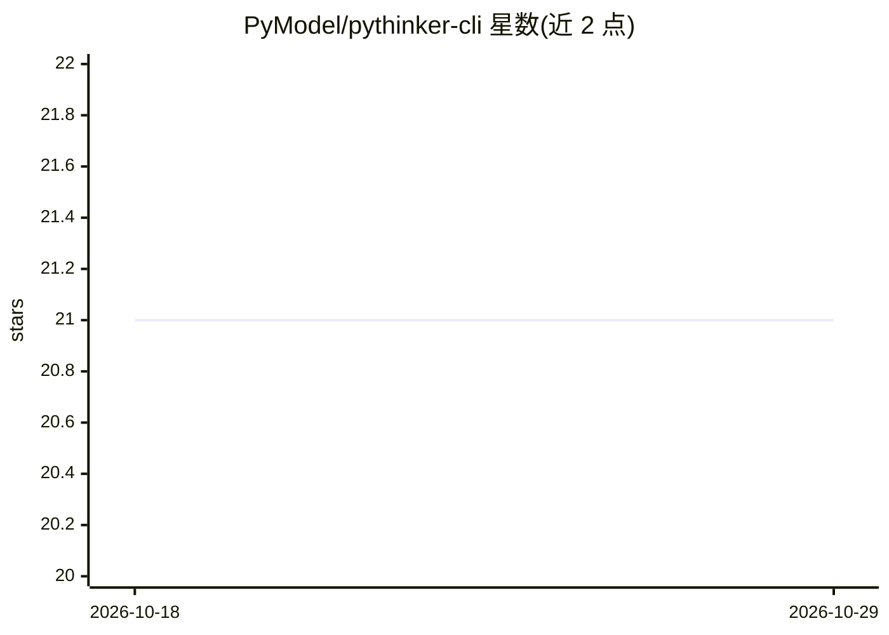

# PyModel/pythinker-cli

⭐ 21 · Python · Apache-2.0 · 推送 2026-10-26 · [GitHub](https://github.com/PyModel/pythinker-cli) · [官网](https://pythinker.com) · 组织维护

**终端里的审查优先 AI 编程 Agent：先评审、扫漏、诊断再写码**

开源终端原生 AI 工程代理 Pythinker Code，工作流为审查优先：先读取仓库、审计 diff、扫描漏洞、根因定位失败，再进行代码修改。内置 code-reviewer、security-reviewer、debugger、coder/implementer 四类子代理，运行于单一迭代循环；支持 Agent Client Protocol（接入 Zed、JetBrains 等 ACP 编辑器）、MCP 工具加载、子代理/技能/钩子/插件扩展、按会话切换模型（含自带 Key 或托管模型），提供本地基准测试与 SWE 风格 fixture。安装覆盖 Windows/macOS/Linux 原生安装包、Homebrew、Docker、Scoop、Nix、deb/rpm 与 pip。

## 筛选速览

| 维度 | 判定 | 备注 |
|---|---|---|
| AI 角色 | `ai-native` | 本体是模型或模型工具 |
| 许可风险 | `permissive` | Apache-2.0 |
| 部署形态 | `desktop` | 安装包/桌面程序 |
| 模型依赖 | local-ok | 支持本地模型 |
| 硬件要求 | — | 无带数字的原话,不猜 |
| 安装摩擦 | `low` | 无编译、无系统依赖或容器化 |
| 成熟度 | — | 结构信号不足 |

## 能力要点

- 审查优先流程：code-reviewer / security-reviewer / debugger / coder 四类子代理
- 支持 ACP 接入 Zed、JetBrains 等 ACP 编辑器，加载 stdio/HTTP MCP 服务器
- Ctrl-X 进入内嵌 shell 命令模式，上下文保留
- 子代理、技能（含 skills-lock.json 哈希锁定）、钩子、插件均为扩展点

## 适用场景

- 在终端里让 AI 先做代码评审与安全扫描再改码
- 通过 /benchmark 在本地跑确定性编码任务并回放产物
- 在 Zed/JetBrains 中经 ACP 内嵌使用同一会话

## 场景标签

`代码审查` `编码 Agent` · 领域:编码与开发

## 证据(README 行号)

> L29: **Pythinker Code** is an open-source, **review-first** AI engineering agent that lives in your terminal. Before it 
> L31: It ships with first-class subagents for each role — `code-reviewer` for severity-scored diff critique, `security-re

## 星数曲线

2026-10-18 21 → 2026-10-29 21（+0）

---
*卡片 v1 · prompt 1.4 · 生成 2026-10-28 · 置信度 mid · 依据 README sha `56aa89bb50bf` · [字段定义](../../DATASET.md)*
