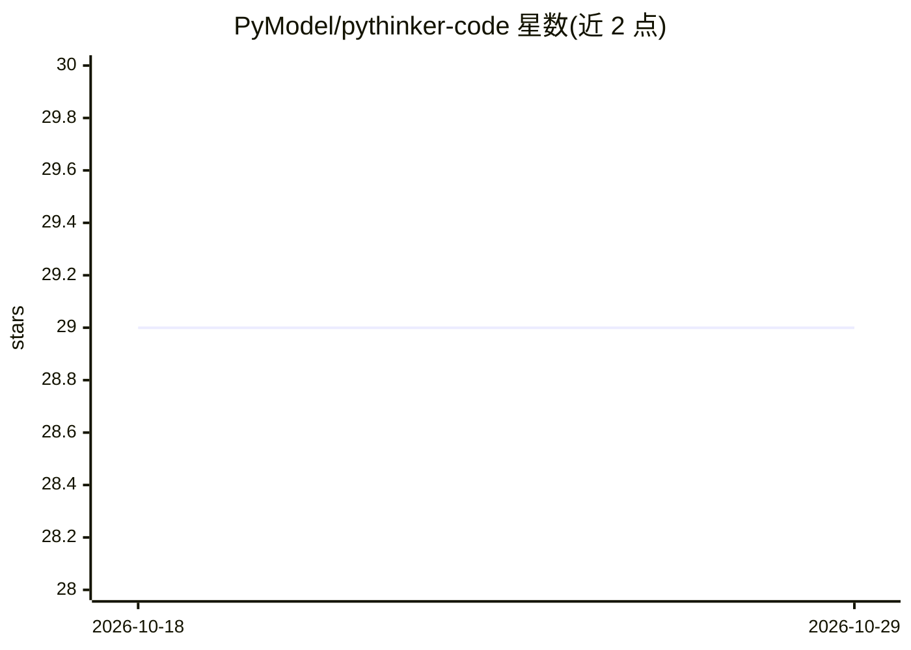

# PyModel/pythinker-code

⭐ 29 · TypeScript · MIT · 推送 2026-10-28 · [GitHub](https://github.com/PyModel/pythinker-code) · [官网](https://pythinker.com) · 组织维护

**终端/桌面/编辑器三形态的 AI 编码 agent，读写代码、跑命令、改文件**

面向开发者的 AI 编码 agent：读取仓库、编辑文件、运行 shell 命令并根据输出迭代，支持测试运行、重构、补测试等任务。任务可拆分给 coder/explore/plan 三个并行子代理；工具调用需用户批准，支持权限预批与生命周期 Hooks；通过 /mcp-config 接入 MCP 服务器（stdio/HTTP），支持仓库本地技能与插件市场。提供 macOS/Windows 桌面应用（本地回环绑定）、原生 CLI 二进制（含 npm/Homebrew/Nix 安装）、以及基于 Agent Client Protocol 的 Zed/JetBrains 编辑器集成；模型支持 Pythinker 自家及任意 OpenAI 兼容端点（含本地模型）。尚无 Linux 桌面构建，Windows 需先装 Git for Windows。

## 筛选速览

| 维度 | 判定 | 备注 |
|---|---|---|
| AI 角色 | `ai-native` | 本体是模型或模型工具 |
| 许可风险 | `permissive` | MIT |
| 部署形态 | `desktop` | 安装包/桌面程序 |
| 模型依赖 | — | README 未给出锁定关系 |
| 硬件要求 | — | 无带数字的原话,不猜 |
| 安装摩擦 | `low` | 无编译、无系统依赖或容器化 |
| 成熟度 | — | 结构信号不足 |

## 能力要点

- coder/explore/plan 子代理并行分工，各自独立上下文
- 工具调用审批模型 + 生命周期 Hooks
- MCP 服务器接入（stdio/HTTP）、技能与插件机制
- 桌面应用 / CLI / ACP 编辑器（Zed、JetBrains）三种使用形态

## 适用场景

- 让 agent 在真实代码库中重构模块、追查 bug、补测试
- 在终端用一条命令启动会话并 OAuth/API key 登录
- 在 Zed 或 JetBrains 编辑器内嵌完整 agent 会话

## 场景标签

`编码 Agent` · 领域:编码与开发

## 证据(README 行号)

> L39: Pythinker searches and reads your repository, edits files, runs shell commands, and reads the output before it deci
> L63: The CLI ships as a native binary, so there is no Node.js prerequisite.

## 星数曲线

2026-10-18 29 → 2026-10-29 29（+0）

---
*卡片 v1 · prompt 1.4 · 生成 2026-10-26 · 置信度 high · 依据 README sha `b6acbf4b6aa9` · [字段定义](../../DATASET.md)*
