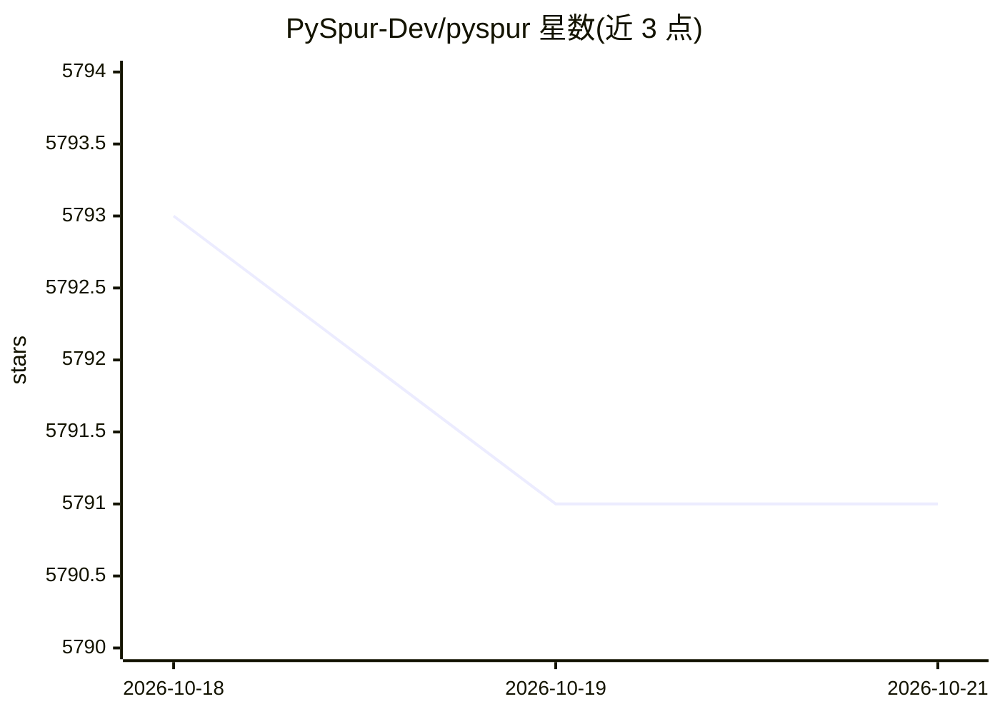

# PySpur-Dev/pyspur

⭐ 5,791 · TypeScript · Apache-2.0 · 推送 2026-06-29 · [GitHub](https://github.com/PySpur-Dev/pyspur) · [官网](https://pyspur.dev) · 组织维护 · 中文 README

**面向 AI 工程师的可视化 agent 工作流构建与迭代平台**

PySpur 提供 agent 工作流的可视化编排与调试环境：用 Python 代码或 UI 构建 agent，定义测试用例，节点级调试后一键发布为 API。核心机制包括 human-in-the-loop 断点、带记忆的迭代工具调用循环、RAG 流水线（解析/分块/嵌入/入向量库）、多模态输入（视频/图像/音频/文本/代码）、执行 trace 捕获与真实数据集评测，支持 100+ LLM 提供商、嵌入器与向量数据库。通过 pip 安装，需 Python 3.11+，默认以 sqlite 启动本地服务，可配置 postgres。开发环境仅支持 Unix-like 系统（Windows 开发不支持），提供 dev container 与 docker-compose 两种方式。

## 筛选速览

| 维度 | 判定 | 备注 |
|---|---|---|
| AI 角色 | `ai-ecosystem` | LLM/agent 周边工具 |
| 许可风险 | `permissive` | Apache-2.0 |
| 部署形态 | `self-host` | docker 或自建部署 |
| 模型依赖 | — | README 未给出锁定关系 |
| 硬件要求 | — | 无带数字的原话,不猜 |
| 安装摩擦 | `low` | 无编译、无系统依赖或容器化 |
| 成熟度 | — | 结构信号不足 |

## 能力要点

- human-in-the-loop 断点：工作流暂停等待人工批准后继续
- RAG 流水线：解析、分块、嵌入、写入向量数据库
- 执行 trace 自动捕获与真实数据集上的 agent 评测
- 支持 100+ LLM 提供商、嵌入器与向量数据库

## 适用场景

- 我想用可视化界面构建和调试 LLM agent 工作流
- 在上线前用真实数据集评测 agent 表现并追踪执行过程
- 为需要人工审核的关键工作流加入审批断点
- 将调好的 agent 一键发布为 API 集成到自己的系统

## 场景标签

`Agent 框架` `工作流自动化` `模型评测` `LLM 可观测性` · 领域:Agent 开发

## 证据(README 行号)

> L3:  Iterate over your agents 10x faster. AI engineers use PySpur to iterate over AI agents visually without reinventing
> L65: - 🎛️ **Any-Vendor-Support**: >100 LLM providers, embedders, and vector DBs.

## 星数曲线

2026-10-18 5,793 → 2026-10-21 5,791（-2）

---
*卡片 v1 · prompt 1.4 · 生成 2026-10-20 · 置信度 high · 依据 README sha `d2a1c390485d` · [字段定义](../../DATASET.md)*
