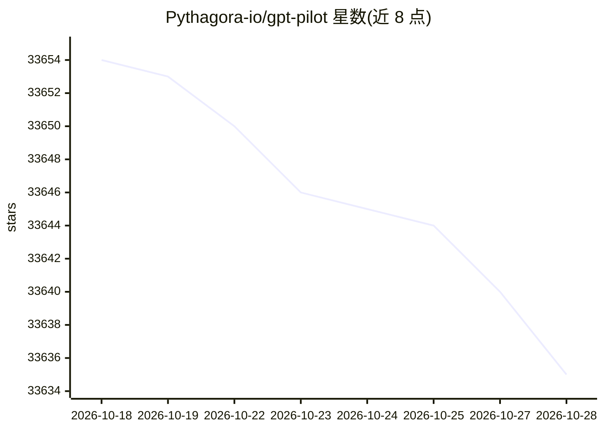

# Pythagora-io/gpt-pilot

⭐ 33,644 · Python · NOASSERTION · 推送 2026-06-18 · [GitHub](https://github.com/Pythagora-io/gpt-pilot) · 组织维护

**给开发者的 AI 编码代理：逐步生成完整应用**

GPT Pilot 是 Pythagora VS Code 扩展的核心技术，也可作为 CLI 工具独立运行。它以多 agent 流水线（规格、架构、任务分解、编码、审查、调试、文档）逐步生成应用代码，开发者监督并修正每个步骤；通过代码过滤机制在 LLM 上下文中只呈现当前任务相关的代码。README 同时包含安全通告：2025 年 8 月至 2026 年 6 月间仓库源码中曾隐藏凭据窃取蠕虫，且项目已停止维护。

## 筛选速览

| 维度 | 判定 | 备注 |
|---|---|---|
| AI 角色 | `ai-native` | 本体是模型或模型工具 |
| 许可风险 | `none` | NOASSERTION |
| 部署形态 | `library` | 以包/库形式分发 |
| 模型依赖 | locked-api |  |
| 硬件要求 | — | 无带数字的原话,不猜 |
| 安装摩擦 | `low` | 无编译、无系统依赖或容器化 |
| 成熟度 | — | 结构信号不足 |

## 动量与使用信号

- 维护:`maintenance` — 距上次 push 121.6 天,年发版 0,51 位贡献者
- 涨星:近 1 天 **+0**(自 20261016 起算)
- 安装:pypi 包 `asyncpg` 月下载 107,296,977

## 能力要点

- 11 种角色的多 agent 流水线（规格/架构/开发/审查/调试/文档等）
- 代码过滤机制使 LLM 对话无需包含整个代码库
- 支持 openai、anthropic、groq 等 provider，Azure 与 OpenRouter 经 openai 设置使用
- 提供 VS Code 扩展与 CLI 两种使用途径

## 适用场景

- 与 AI 协作逐步开发完整应用并由开发者审查修正
- 研究 LLM 生成可用应用的极限（项目定位为研究项目）
- 继续开发已生成的应用：追加功能指令

## 场景标签

`编码 Agent` `多智能体` · 领域:Agent 开发

## 证据(README 行号)

> L40: GPT Pilot is the core technology for the Pythagora VS Code extension that aims to provide **the first real AI devel
> L46: GPT Pilot aims to research how much LLMs can be utilized to generate fully working, production-ready apps while the
> L151: # 🕴How's GPT Pilot different from _Smol developer_ and _GPT engineer_?

## 星数曲线

2026-10-18 33,654 → 2026-10-28 33,635（-19）

---
*卡片 v1 · prompt 1.4 · 生成 2026-10-18 · 置信度 mid · 依据 README sha `c66d0d07022d` · [字段定义](../../DATASET.md)*
