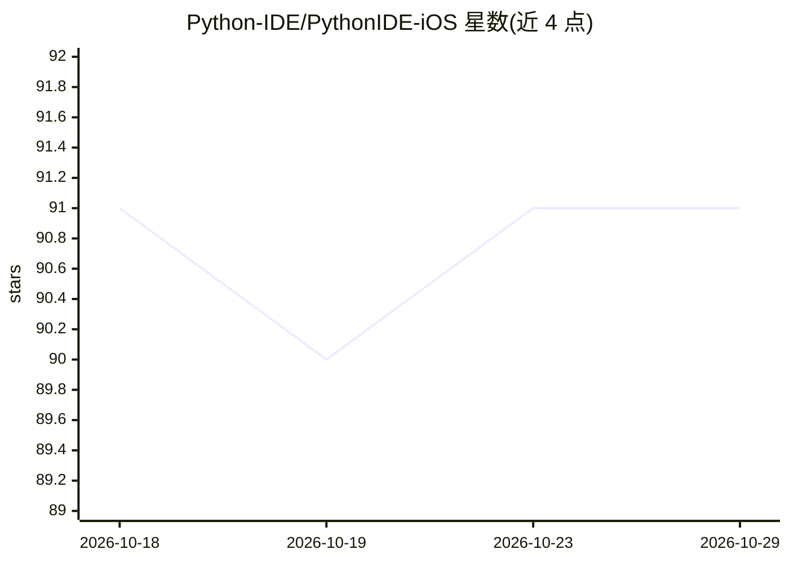

# Python-IDE/PythonIDE-iOS

⭐ 91 · 推送 2026-08-29 · [GitHub](https://github.com/Python-IDE/PythonIDE-iOS) · [官网](https://pythonide.xin/) · 组织维护 · 中文 README

**在 iPhone/iPad 上本地开发 Python 与 Web 的 IDE 应用，含 AI Agent**

App Store 发行的 iOS/iPadOS 开发工作台：内置 Python 3.14.6 运行时（预装 45 个原生包、63 个纯 Python 包，含 NumPy/SciPy/pandas 等），支持多文件 Python 项目编辑与断点调试、HTML/CSS/JavaScript 项目与即时预览、.ipynb Notebook、SSH/SFTP/Git 远程开发、iOS 原生能力 Python 接口，以及用 Python 构建原生界面 MiniApp 与桌面小组件。AI Agent 可读取/修改项目文件、运行代码、分析错误并调用 Git/SSH 等工具，支持平台额度或 BYOK。系统要求 iOS/iPadOS 16.2 以上；本仓库仅为文档，商业源码不公开。

## 筛选速览

| 维度 | 判定 | 备注 |
|---|---|---|
| AI 角色 | `ai-enhanced` | 去掉 AI 部分产品仍成立 |
| 许可风险 | `none` | — |
| 部署形态 | `library` | 以包/库形式分发 |
| 模型依赖 | — | README 未给出锁定关系 |
| 硬件要求 | — | 无带数字的原话,不猜 |
| 安装摩擦 | `low` | 无编译、无系统依赖或容器化 |
| 成熟度 | — | 结构信号不足 |

## 能力要点

- 内置 Python 3.14.6，预装 45 个原生包与 63 个纯 Python 包
- AI Agent 可读写文件、运行代码、修复错误并调用 Git/SSH/MiniApp 等工具，支持 BYOK
- 用 Python 构建带原生界面的 MiniApp，以及 Widget、快捷指令与 Siri 自动化
- 通过 npx pythonide-cli 连接 VS Code/Cursor/Zed 在真机 Runtime 运行

## 适用场景

- 在 iPad 上编写并调试 Python 与 Web 多文件项目
- 让 AI Agent 在真实项目中改代码、跑代码并修复错误
- 用 Python 调用相机、蓝牙、HealthKit 等 iOS 原生能力开发工具
- SSH 连接服务器进行远程开发与部署

## 场景标签

`编码 Agent` · 领域:编码与开发

## 证据(README 行号)

> L23: PythonIDE 不只是移动端 Python 编辑器。它把 Python 脚本与 HTML/CSS/JavaScript 多文件项目连接到 Notebook、AI Agent、MiniApp、桌面开发、小组件、快捷指令、SSH、
> L36: |**AI Agent**|读取和修改项目文件、运行 Python、分析错误、调用 Git/SSH/MiniApp/网页及原生工具；支持平台额度与 BYOK|

## 星数曲线

2026-10-18 91 → 2026-10-29 91（+0）

---
*卡片 v1 · prompt 1.4 · 生成 2026-10-23 · 置信度 mid · 依据 README sha `e8af8a31a492` · [字段定义](../../DATASET.md)*
