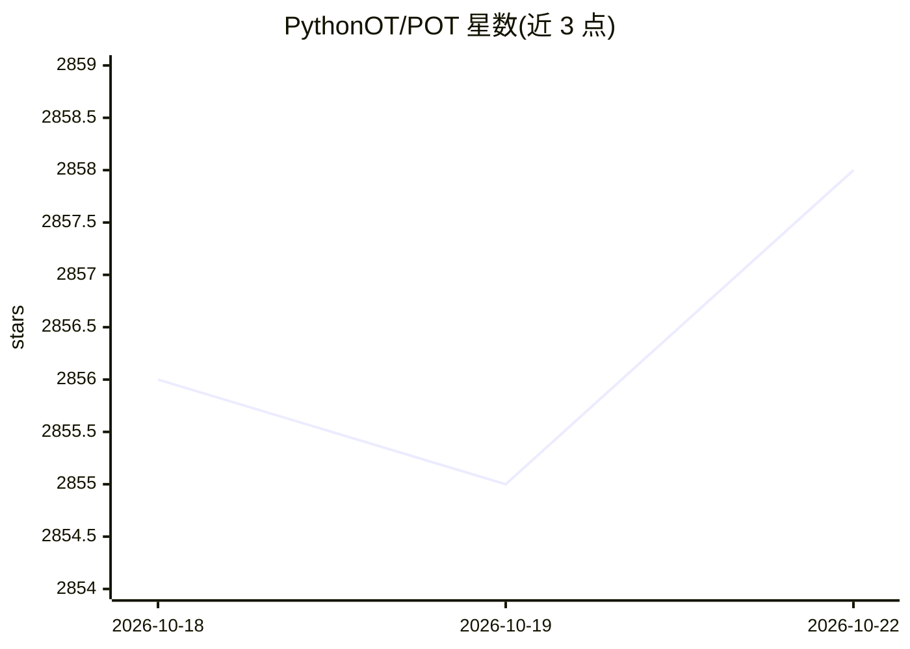

# PythonOT/POT

⭐ 2,858 · Python · MIT · 推送 2026-10-20 · [GitHub](https://github.com/PythonOT/POT) · [官网](https://PythonOT.github.io/) · 组织维护

**为科研与工程提供最优传输问题求解器的 Python 库**

面向信号、图像处理与机器学习研究者和开发者的开源 Python 库，提供大量可微分的 OT 求解器：精确线性 OT、熵/二次正则化 OT、Gromov-Wasserstein 及 Fused GW、非平衡/部分 OT、Wasserstein 重心、Sliced OT 等，并含域适应、OT 映射估计、子空间学习、GNN 层等机器学习相关求解器。支持 Pytorch/Jax/Tensorflow/Numpy/Cupy 多后端数组。安装需 C++ 编译器构建 EMD 求解器（pip/conda 安装时已含预编译）；可选依赖含 GPL 许可的 cvxopt。模块导入名为 ot 而非 pot。

## 筛选速览

| 维度 | 判定 | 备注 |
|---|---|---|
| AI 角色 | `ai-native` | 本体是模型或模型工具 |
| 许可风险 | `permissive` | MIT |
| 部署形态 | `library` | 以包/库形式分发 |
| 模型依赖 | — | README 未给出锁定关系 |
| 硬件要求 | — | 无带数字的原话,不猜 |
| 安装摩擦 | `low` | 无编译、无系统依赖或容器化 |
| 成熟度 | — | 结构信号不足 |

## 能力要点

- 覆盖线性/正则化/GW/非平衡/部分/Sliced 等多类可微 OT 求解器与重心计算
- Pytorch/Jax/Tensorflow/Numpy/Cupy 多后端数组支持
- 含域适应、OT 映射估计、Wasserstein 判别分析、GNN OT 层等 ML 求解器
- 在 Linux/macOS/Windows 上测试，提供 pip 与 conda-forge 安装

## 适用场景

- 计算分布间的 Wasserstein/Gromov-Wasserstein 距离
- 用 OT 做域适应或映射估计
- 计算 Wasserstein 重心用于分布平均

## 场景标签

 · 领域:机器学习/数值优化

## 证据(README 行号)

> L11: This open source Python library provides several solvers for optimization
> L29: * Many ML related solvers, such as domain adaptation, optimal transport mapping
> L31: * Several backends for easy use with Pytorch, Jax, Tensorflow, Numpy and Cupy arrays.

## 星数曲线

2026-10-18 2,856 → 2026-10-22 2,858（+2）

---
*卡片 v1 · prompt 1.4 · 生成 2026-10-21 · 置信度 high · 依据 README sha `9454ce02322b` · [字段定义](../../DATASET.md)*
