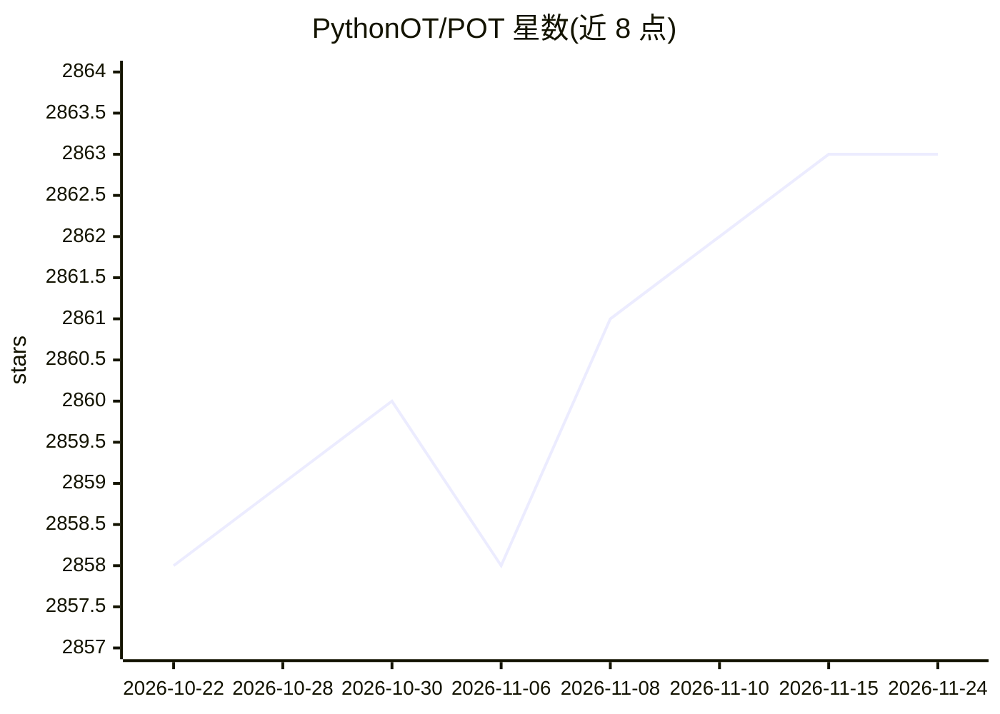

# PythonOT/POT

⭐ 2,864 · Python · MIT · 推送 2026-11-19 · [GitHub](https://github.com/PythonOT/POT) · [官网](https://PythonOT.github.io/) · 组织维护

**面向机器学习与信号图像处理的Python最优传输求解库**

MIT 许可的开源 Python 库，为最优传输相关优化问题提供多种求解器，应用于信号处理、图像处理和机器学习。核心是一批可微分 OT 求解器（精确线性 OT、熵/二次正则化、Gromov-Wasserstein、非平衡与部分 OT、barycenter 等），并包含领域自适应、OT 映射估计、子空间学习、GNN 层等 ML 求解器。支持 PyTorch/Jax/Tensorflow/Numpy/Cupy 多后端数组。安装需 C++ 编译器构建 EMD 求解器，依赖 Numpy/Scipy。

## 筛选速览

| 维度 | 判定 | 备注 |
|---|---|---|
| AI 角色 | `ai-native` | 本体是模型或模型工具 |
| 许可风险 | `permissive` | MIT |
| 部署形态 | `library` | 以包/库形式分发 |
| 模型依赖 | — | README 未给出锁定关系 |
| 硬件要求 | — | 无带数字的原话,不猜 |
| 安装摩擦 | `low` | 无编译、无系统依赖或容器化 |
| 成熟度 | — | 结构信号不足 |

## 能力要点

- 可微分 OT 求解器集合：精确线性、熵正则化、GW/Fused GW、非平衡与部分 OT
- ML 相关求解器：领域自适应、OT 映射估计、GNN 层（TFGW/OT-GNN）
- 支持 PyTorch/Jax/Tensorflow/Numpy/Cupy 数组后端
- 1D、圆上及 GMM 间的快速 OT 求解器

## 适用场景

- 计算分布间的 Wasserstein 距离与 barycenter
- 做分布间的领域自适应与 OT 映射估计
- 在深度学习模型中嵌入可微分 OT 损失或图层

## 场景标签

 · 领域:机器学习/科学计算

## 证据(README 行号)

> L11: This open source Python library provides several solvers for optimization
> L29: * Many ML related solvers, such as domain adaptation, optimal transport mapping
> L30:  estimation, subspace learning, Graph Neural Networks (GNNs) layers.

## 星数曲线

2026-10-22 2,858 → 2026-11-24 2,863（+5）

---
*卡片 v1 · prompt 1.4 · 生成 2026-11-23 · 置信度 high · 依据 README sha `297a7ea05db3` · [字段定义](../../DATASET.md)*
