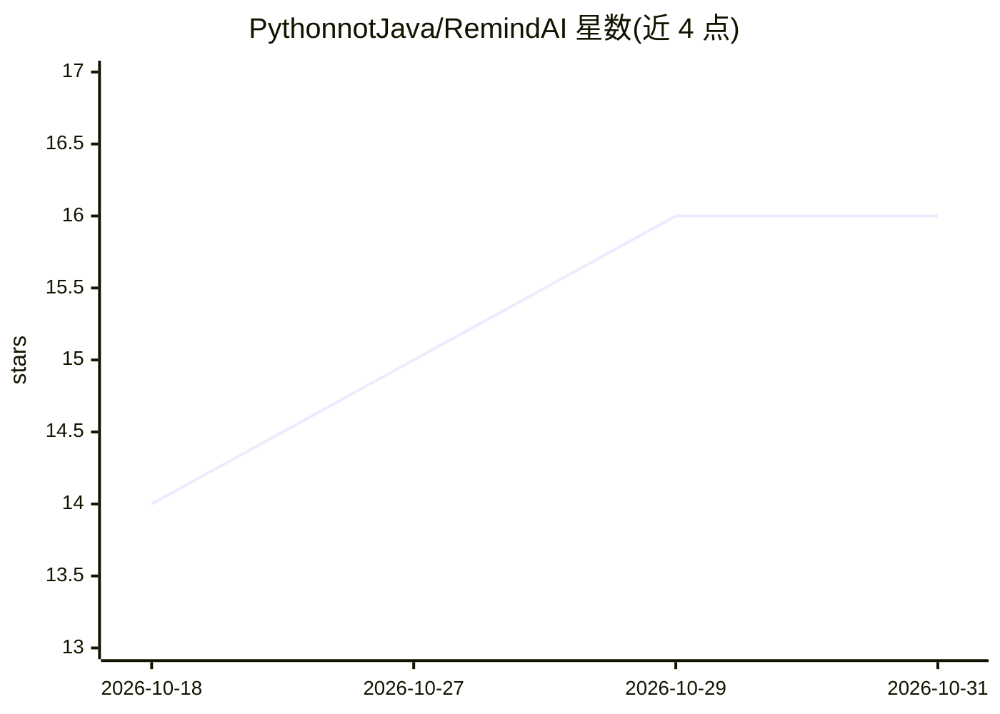

# PythonnotJava/RemindAI

⭐ 16 · Dart · MIT · 推送 2026-07-29 · [GitHub](https://github.com/PythonnotJava/RemindAI) · [官网](https://www.robot-shadow.cn/extend/remindai/) · 个人维护 · 中文 README

**桌面 AI 助手：让大模型直接操作文件、执行代码、管理记忆**

基于 Flutter 的开源桌面 AI 助手，核心理念是为大模型提供工具外壳（ToolShell）：内置沙盒文件系统、Python/Shell/JS 执行器、Qdrant+SQLite 向量记忆、MCP 协议接入（stdio/SSE/Streamable HTTP）与四层技能系统（L1 元技能/L2 全局/L3 临时，L4 规划中）。支持 OpenAI/Anthropic/Gemini 三家适配，含多 Agent 协作、内置 HTTP API 服务器与像素宠物 Agent。Windows 提供预编译安装包，Linux/macOS 需 Flutter SDK 从源码构建。

## 筛选速览

| 维度 | 判定 | 备注 |
|---|---|---|
| AI 角色 | `ai-native` | 本体是模型或模型工具 |
| 许可风险 | `permissive` | MIT |
| 部署形态 | `None` |  |
| 模型依赖 | locked-api |  |
| 硬件要求 | — | 无带数字的原话,不猜 |
| 安装摩擦 | `low` | 无编译、无系统依赖或容器化 |
| 成熟度 | `idea` | |

## 能力要点

- ToolShell 内置沙盒文件系统与 Python/Shell/JS 执行器
- 四层技能系统，SKILL.md + tools.json 格式，ZIP 批量导入
- Qdrant + SQLite 双写向量记忆与软失效过滤
- 内置 HTTP API 服务器，对外暴露 OpenAI 聚合 / Claude Agent / Claude 代理三种端点

## 适用场景

- 让 AI 在本地直接读写文件、执行代码完成实际任务
- 通过 MCP 协议接入外部工具并统一管理技能
- 搭建带持久记忆的桌面个人 AI 工作台

## 场景标签

`AI 助手` · 领域:对话与助手

## 证据(README 行号)

> L21: RemindAI 是一个**开源桌面 AI 助手**，核心理念是为大模型提供一层完整的**工具外壳 (ToolShell)**，让 AI 不仅能聊天，还能直接操作文件、执行代码、调用外部工具、管理记忆、自主规划任务——成为真正能「
> L71: |AI 对话核心 (LLM + tool calling)|✅|AgentLoop 流式循环 + 事件驱动 UI|
> L102: |🎨 多模型|OpenAI/Anthropic/Gemini 原生适配 + 流式推理链 + 多模态|

## 星数曲线

2026-10-18 14 → 2026-10-31 16（+2）

---
*卡片 v1 · prompt 1.4 · 生成 2026-10-30 · 置信度 high · 依据 README sha `afa7f29288e9` · [字段定义](../../DATASET.md)*
