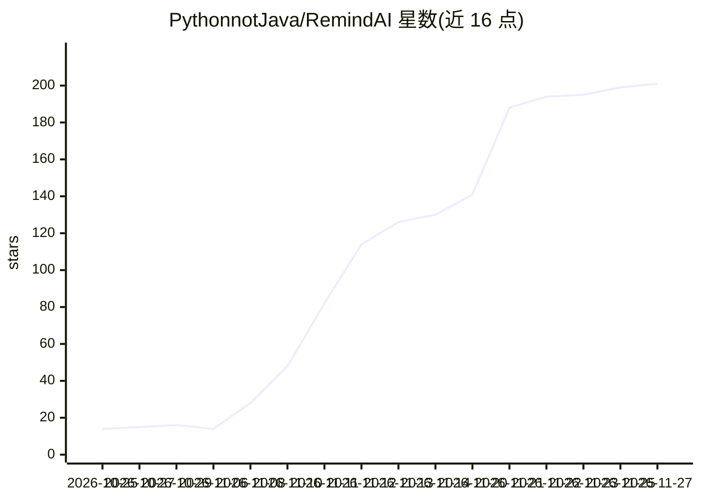

# PythonnotJava/RemindAI

⭐ 201 · Dart · MIT · 推送 2026-11-08 · [GitHub](https://github.com/PythonnotJava/RemindAI) · [官网](https://www.robot-shadow.cn/extend/remindai/) · 个人维护 · 中文 README

**桌面 AI 工作台：接模型、装技能、连 MCP、建持久记忆**

基于 Flutter 构建的开源桌面 AI 助手应用，功能覆盖工具执行、技能安装、MCP 服务器连接与持久记忆构建，支持接入多个模型并在同一界面使用。Windows 平台提供预编译安装包，Linux/macOS 需从源码构建（需 Flutter SDK >= 3.12.1）。README 附优化参考论文链接，并声明项目现由自身和其他 Agent 维护、不再发布新的编译版本。

## 筛选速览

| 维度 | 判定 | 备注 |
|---|---|---|
| AI 角色 | `ai-native` | 本体是模型或模型工具 |
| 许可风险 | `permissive` | MIT |
| 部署形态 | `None` |  |
| 模型依赖 | — | README 未给出锁定关系 |
| 硬件要求 | — | 无带数字的原话,不猜 |
| 安装摩擦 | `low` | 无编译、无系统依赖或容器化 |
| 成熟度 | `idea` | |

## 能力要点

- 在一个桌面界面接入多个模型
- 支持安装技能与执行工具
- 支持连接 MCP 服务器与构建持久记忆
- Windows 提供预编译安装包

## 适用场景

- 在同一桌面应用中切换使用多个模型
- 通过技能与 MCP 服务器扩展助手能力
- 为个人工作流构建带持久记忆的 AI 助手

## 场景标签

`AI 助手` · 领域:对话与助手

## 证据(README 行号)

> L3:  开源桌面 AI 助手，不再只是对话
> L10:  Flutter
> L11:  MCP

## 星数曲线

2026-10-25 14 → 2026-11-27 201（+187）

---
*卡片 v1 · prompt 1.4 · 生成 2026-11-25 · 置信度 mid · 依据 README sha `b8636e687467` · [字段定义](../../DATASET.md)*
