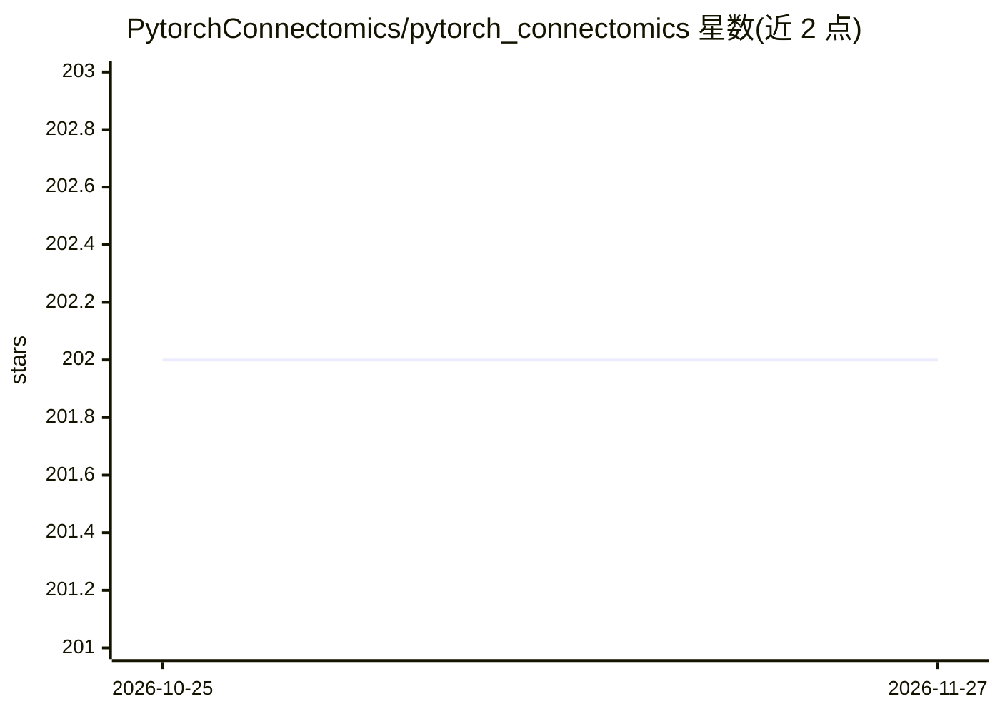

# PytorchConnectomics/pytorch_connectomics

⭐ 202 · Python · MIT · 推送 2026-11-23 · [GitHub](https://github.com/PytorchConnectomics/pytorch_connectomics) · [官网](https://pytorchconnectomics.github.io/pytorch_connectomics/) · 组织维护

**面向神经科学家的 EM 连接组学分割工具箱**

基于 PyTorch 的 2D/3D 电子显微镜（EM）体积分割工具箱，覆盖训练、推理、解码、评估四个环节，按神经元、线粒体、突触、囊泡、细胞核等结构提供各数据集的教程配置与预训练权重（托管于 Hugging Face）。支持零样本预测与微调，内置 Optuna 解码参数调优，提供单 CLI 入口且所有字段可命令行覆盖。安装方式包括自动脚本与手动安装，另提供由 claude/codex CLI agent 驱动的安装与工作流路径。

## 筛选速览

| 维度 | 判定 | 备注 |
|---|---|---|
| AI 角色 | `ai-native` | 本体是模型或模型工具 |
| 许可风险 | `permissive` | MIT |
| 部署形态 | `None` |  |
| 模型依赖 | — | README 未给出锁定关系 |
| 硬件要求 | — | 无带数字的原话,不猜 |
| 安装摩擦 | `medium` | 含编译或系统依赖之一 |
| 成熟度 | — | 结构信号不足 |

## 能力要点

- 内置多数据集基准教程（EMNeuron、Lucchi++、CREMI 等）与预训练 checkpoint
- 预训练 EMNeuron 模型支持零样本推理与微调
- 五阶段流水线（train→infer→decode→evaluate→tune），单 CLI 调度且字段可覆盖
- 支持 Optuna 扫描解码参数

## 适用场景

- 在自己的 EM 体积上做神经元或线粒体分割
- 在内置基准上训练并评估分割模型
- 从已发表 checkpoint 微调后对新体积做预测

## 场景标签

`教程课程` `目标检测` `微调` `模型训练` · 领域:学习与行业

## 证据(README 行号)

> L4: **Modern deep learning for 2D / 3D connectomics.** Train, run inference, decode, and evaluate segmentation pipelines
> L141: EM volume ─[train]─▶ checkpoint ─[infer]─▶ representation ─[decode]─▶ instances ─[evaluate]─▶ metrics
> L158: @article{lin2021pytorch,

## 星数曲线

2026-10-25 202 → 2026-11-27 202（+0）

---
*卡片 v1 · prompt 1.4 · 生成 2026-11-25 · 置信度 high · 依据 README sha `191694eb88ab` · [字段定义](../../DATASET.md)*
