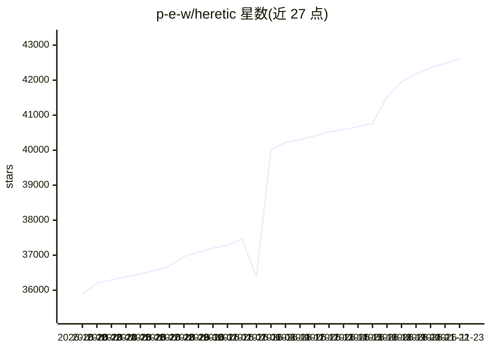

# p-e-w/heretic

⭐ 42,610 · Python · AGPL-3.0 · 推送 2026-11-19 · [GitHub](https://github.com/p-e-w/heretic) · [官网](https://heretic-project.org) · 个人维护

**在消费级硬件上免训练修改 LLM 行为的工具**

Heretic 对用户可在本地硬件上运行的 LLM 做免训练行为修改：默认移除拒答/审查，另可通过配置文件减少 slop、谄媚、幽默、缩短回复长度等。机制是可插拔 modifier（默认 ARA，另有 abliteration）配合基于 Optuna 的 TPE 超参优化器，按 scorer（拒答率、KL 散度等）优化，支持自定义 scorer/modifier 插件。处理前自动测硬件定 batch size，处理后可保存、上传 Hugging Face、测试或跑基准；支持生成复现清单（Grimoire）。支持多数 dense、多模态、MoE 与混合架构模型。

## 筛选速览

| 维度 | 判定 | 备注 |
|---|---|---|
| AI 角色 | `ai-ecosystem` | LLM/agent 周边工具 |
| 许可风险 | `viral` | AGPL-3.0 |
| 部署形态 | `library` | 以包/库形式分发 |
| 模型依赖 | — | README 未给出锁定关系 |
| 硬件要求 | — | 无带数字的原话,不猜 |
| 安装摩擦 | `low` | 无编译、无系统依赖或容器化 |
| 成熟度 | — | 结构信号不足 |

## 动量与使用信号

- 维护:`active` — 距上次 push 0.8 天,年发版 5,35 位贡献者
- 涨星:近 1 天 **+141**(自 20261016 起算)
- 安装:pypi 包 `heretic-llm` 月下载 6,107

## 能力要点

- 免训练修改模型行为：默认移除拒答/审查，另有 noslop/nosyco 等配置
- 可插拔 scorer 与 modifier 插件（ARA、abliteration），Optuna TPE 优化
- 复现清单机制：reproduce.json 可字节级重建模型，Grimoire 清单库可本地收集
- 支持 4-bit 量化处理以降低 VRAM 需求

## 适用场景

- 在自己显卡上对开源模型做拒答抑制并上传 Hugging Face
- 按配置调整模型的谄媚、幽默、回复长度等行为
- 用 reproduce.json 在匹配环境中复现他人发布的修改模型

## 场景标签

 · 领域:LLM 模型修改工具

## 证据(README 行号)

> L28: language models. It does not perform expensive training; rather, it uses
> L133: Heretic combines a pluggable modifier (interface in
> L26: Heretic is a unique tool that lets you do what only corporations with access

## 星数曲线

2026-10-20 35,889 → 2026-11-23 42,610（+6,721）

---
*卡片 v1 · prompt 1.4 · 生成 2026-11-22 · 置信度 mid · 依据 README sha `776e5a7f225e` · [字段定义](../../DATASET.md)*
