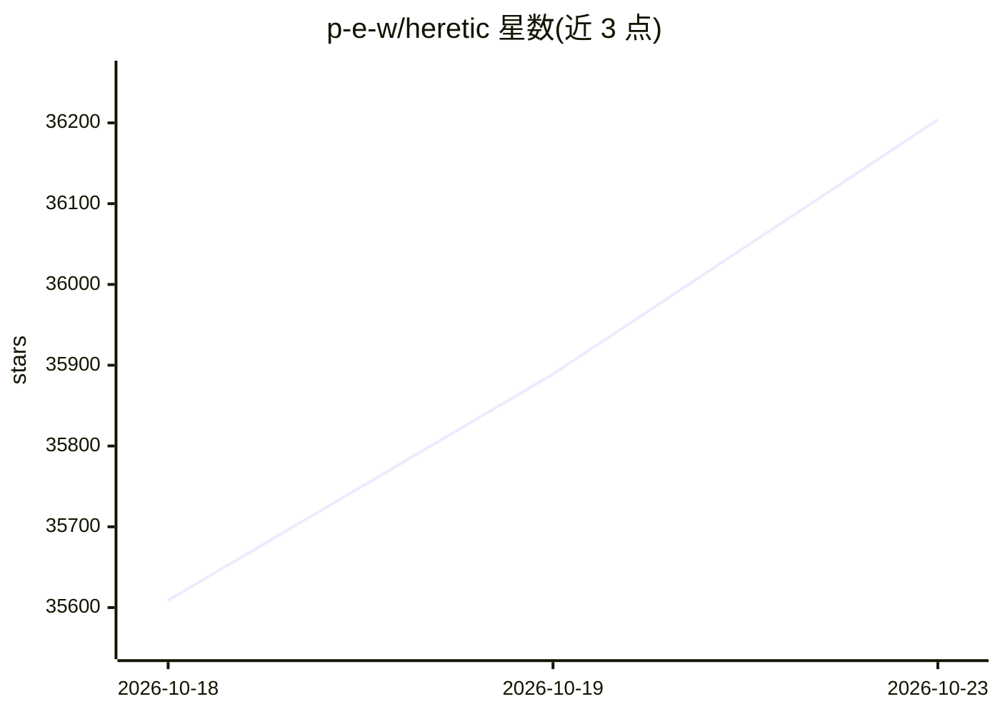

# p-e-w/heretic

⭐ 36,204 · Python · AGPL-3.0 · 推送 2026-10-20 · [GitHub](https://github.com/p-e-w/heretic) · [官网](https://heretic-project.org) · 个人维护

**自动去除语言模型审查（abliteration）的命令行工具**

Heretic 是一个对 transformer 语言模型执行去审查（移除安全对齐）的工具，采用方向消融（abliteration）实现，并用 Optuna 的 TPE 参数优化器自动搜索消融参数，目标为同时最小化拒答数与与原模型的 KL 散度。支持多数稠密模型、部分多模态、MoE 及混合架构，纯状态空间模型暂不支持。通过 pip 安装后以命令行运行，提供内置评估、量化（bitsandbytes）、保存、上传 Hugging Face 与聊天测试等功能。

## 筛选速览

| 维度 | 判定 | 备注 |
|---|---|---|
| AI 角色 | `ai-ecosystem` | LLM/agent 周边工具 |
| 许可风险 | `viral` | AGPL-3.0 |
| 部署形态 | `library` | 以包/库形式分发 |
| 模型依赖 | — | README 未给出锁定关系 |
| 硬件要求 | — | 无带数字的原话,不猜 |
| 安装摩擦 | `low` | 无编译、无系统依赖或容器化 |
| 成熟度 | — | 结构信号不足 |

## 动量与使用信号

- 维护:`active` — 距上次 push 0.8 天,年发版 5,35 位贡献者
- 涨星:近 1 天 **+141**(自 20261016 起算)
- 安装:pypi 包 `heretic-llm` 月下载 6,107

## 能力要点

- 方向消融 + TPE 自动参数优化，无需手动调参与 transformer 内部知识
- 同时最小化拒答数与 KL 散度以保留原模型能力
- 运行前自动基准测试系统以确定最优 batch size
- 支持 bitsandbytes 量化以降低 VRAM 占用，完成后可上传 Hugging Face

## 适用场景

- 对已发布的开源模型自动生成去审查版本
- 复现/评估消融模型的拒答率与 KL 散度指标
- 在不了解 transformer 内部机制的情况下批量处理模型

## 场景标签

 · 领域:LLM 模型修改工具

## 证据(README 行号)

> L7: Heretic is a tool that removes censorship (aka "safety alignment") from
> L13: with a TPE-based parameter optimizer powered by Optuna.
> L89: pip install -U heretic-llm

## 星数曲线

2026-10-18 35,609 → 2026-10-23 36,204（+595）

---
*卡片 v1 · prompt 1.4 · 生成 2026-10-18 · 置信度 high · 依据 README sha `59a085290697` · [字段定义](../../DATASET.md)*
