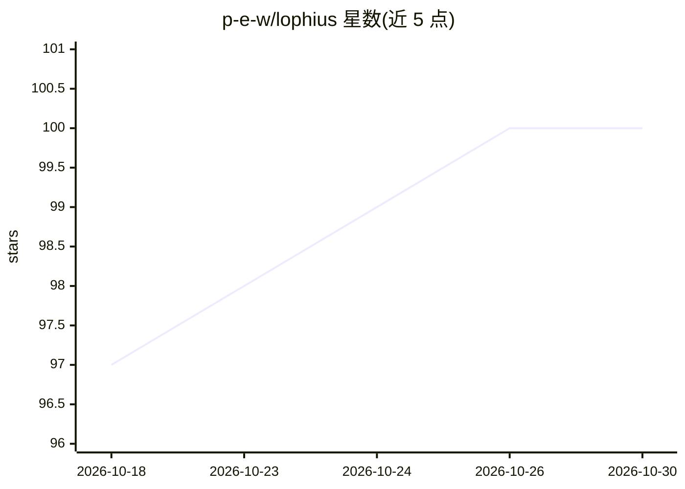

# p-e-w/lophius

⭐ 100 · Python · AGPL-3.0 · 推送 2026-08-09 · [GitHub](https://github.com/p-e-w/lophius) · [官网](https://lophius.org) · 个人维护

**语言模型研究工作台：供研究者开展 LLM 实验**

名为 Lophius 的语言模型研究工作台，面向从事语言模型研究的人员。README 本身极简：声明项目名称、定位（A workbench for language model research）、指向官网 https://lophius.org 获取详情，并附带截图与 Discord/Hugging Face 社区链接。代码由 Philipp Emanuel Weidmann 及贡献者维护。README 未给出安装命令、功能列表或支持的模型清单，具体能力需查阅官网确认。

## 筛选速览

| 维度 | 判定 | 备注 |
|---|---|---|
| AI 角色 | `ai-ecosystem` | LLM/agent 周边工具 |
| 许可风险 | `viral` | AGPL-3.0 |
| 部署形态 | `None` |  |
| 模型依赖 | — | README 未给出锁定关系 |
| 硬件要求 | — | 无带数字的原话,不猜 |
| 安装摩擦 | `low` | 无编译、无系统依赖或容器化 |
| 成熟度 | — | 结构信号不足 |

## 能力要点

- 自我定位为语言模型研究工作台
- 提供官网 https://lophius.org 作为详细文档入口
- 附 Discord 与 Hugging Face 社区链接

## 适用场景

- 开展语言模型研究实验（具体功能见官网）
- 加入其 Discord/Hugging Face 社区跟进项目

## 场景标签

 · 领域:LLM 研究工具

## 证据(README 行号)

> L3: # Lophius: A workbench for language model research Discord Follow us on Hugging Face

## 星数曲线

2026-10-18 97 → 2026-10-30 100（+3）

---
*卡片 v1 · prompt 1.4 · 生成 2026-10-23 · 置信度 low · 依据 README sha `cf46b57179e9` · [字段定义](../../DATASET.md)*
