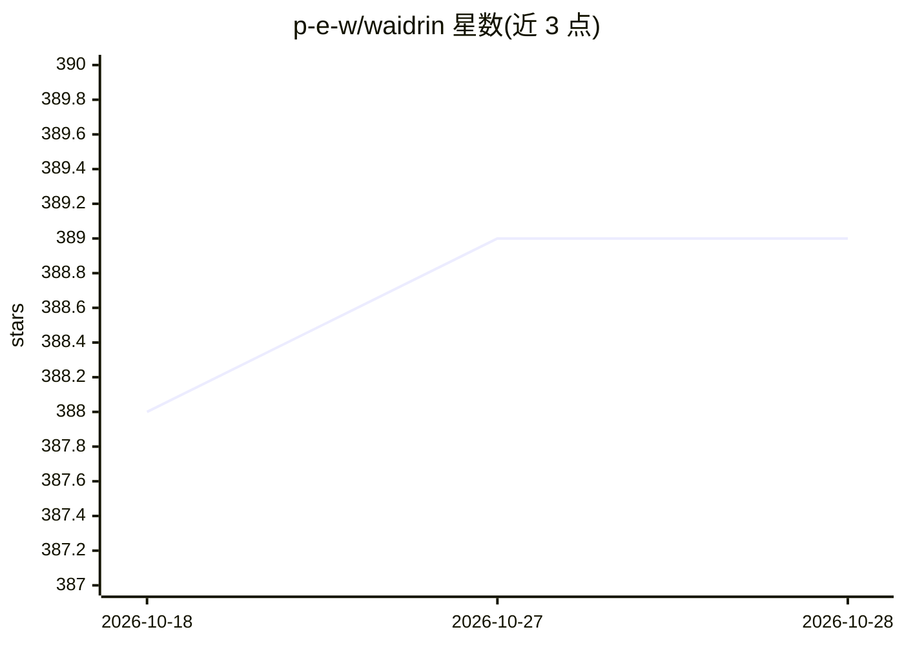

# p-e-w/waidrin

⭐ 389 · TypeScript · AGPL-3.0 · 推送 2026-02-19 · [GitHub](https://github.com/p-e-w/waidrin) · [官网](https://waidrin.com) · 个人维护

**LLM 驱动的角色扮演游戏引擎，含 React 前端**

以 LLM 为核心的角色扮演游戏引擎：采用异步、全类型校验的状态机，基于 JSON schema 的约束生成在剧情推进中动态创建地点与角色并持续追踪，可处理数千角色与地点。引擎为 headless 设计，可驱动任意前端，同时附带共同开发的 React 前端，包含 AI 生成插图。每回合提供多个 AI 建议动作，也接受自由文本输入；当前仅实现奇幻类型。需配合本地 llama.cpp server 运行，通过 git clone 与 npm 安装。

## 筛选速览

| 维度 | 判定 | 备注 |
|---|---|---|
| AI 角色 | `ai-native` | 本体是模型或模型工具 |
| 许可风险 | `viral` | AGPL-3.0 |
| 部署形态 | `library` | 以包/库形式分发 |
| 模型依赖 | — | README 未给出锁定关系 |
| 硬件要求 | — | 无带数字的原话,不猜 |
| 安装摩擦 | `low` | 无编译、无系统依赖或容器化 |
| 成熟度 | — | 结构信号不足 |

## 能力要点

- 基于 JSON schema 约束生成的状态机动态创建并追踪地点与角色
- 引擎 headless，可驱动任意前端，附带 React 前端
- 每回合提供 AI 建议动作，也支持自由文本输入
- 支持潜在数千角色与地点的追踪

## 适用场景

- 游玩 LLM 驱动的文字角色扮演冒险
- 作为 headless 引擎接入自定义前端构建互动叙事应用
- 以 CYOA 结合自由输入的方式展开生成式剧情

## 场景标签

`AI 写作` · 领域:内容生成

## 证据(README 行号)

> L3: **Waidrin** is a purpose-built role-playing game engine powered by an LLM.
> L7: Waidrin produces structured narrative events, not just chat messages.

## 星数曲线

2026-10-18 388 → 2026-10-28 389（+1）

---
*卡片 v1 · prompt 1.4 · 生成 2026-10-22 · 置信度 high · 依据 README sha `df038148ce99` · [字段定义](../../DATASET.md)*
