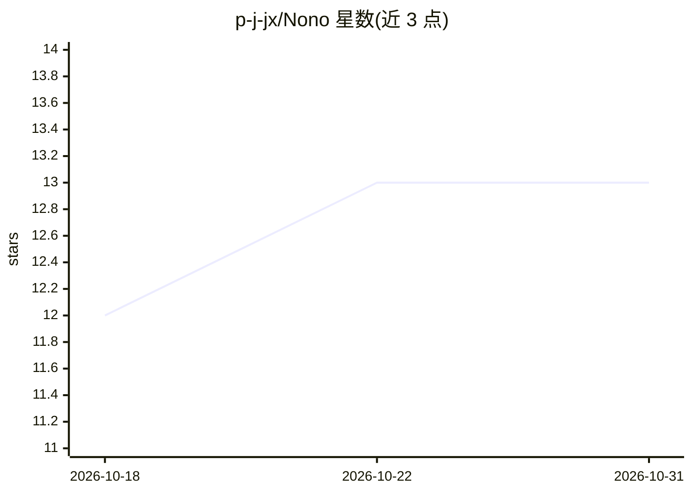

# p-j-jx/Nono

⭐ 13 · TypeScript · MIT · 推送 2026-05-31 · [GitHub](https://github.com/p-j-jx/Nono) · [官网](https://ai-cea.com  ) · 个人维护 · 中文 README

**面向跨境电商卖家的 AI 商品文案与图片生成 Web 应用**

基于 Next.js 16 / React 19 / Prisma 7 构建的 Web 应用，面向中国跨境卖家：针对 Amazon A9、Shopify、TikTok Shop 分别生成多语言（8 种）商品文案，调用 AI 生成商品主图与场景图；另含纯规则的 Listing 合规检测（违禁词、长度、关键词覆盖）、竞品关键词差异分析、欧盟 VAT/美国销售税等税务计算，以及 Amazon TSV / Shopify CSV 导出。AI 通过 DeepSeek / OpenAI API（可切换）接入，API Key 可选不填时应用仍可启动；支持 Vercel 一键部署与本地 npm 启动。

## 筛选速览

| 维度 | 判定 | 备注 |
|---|---|---|
| AI 角色 | `ai-native` | 本体是模型或模型工具 |
| 许可风险 | `permissive` | MIT |
| 部署形态 | `self-host` | docker 或自建部署 |
| 模型依赖 | locked-api |  |
| 硬件要求 | — | 无带数字的原话,不猜 |
| 安装摩擦 | `low` | 无编译、无系统依赖或容器化 |
| 成熟度 | — | 结构信号不足 |

## 能力要点

- 针对 Amazon/Shopify/TikTok Shop 的多平台多语言 AI 文案生成
- AI 商品图生成（主图/场景图/Lifestyle 图）
- 纯规则 Listing 合规检测与竞品关键词差异分析
- Amazon TSV / Shopify CSV / TXT 格式导出

## 适用场景

- 为多个电商平台批量生成商品文案与营销内容
- 检查商品 Listing 的违禁词与合规问题
- 计算欧盟 VAT、美国销售税等跨境税务

## 场景标签

`AI 写作` `图像生成` · 领域:内容生成

## 证据(README 行号)

> L5: 为跨境电商卖家自动生成多平台商品文案与营销内容
> L21: 针对 Amazon A9 算法、Shopify 品牌站、TikTok 短视频带货分别优化的 AI 文案生成。
> L65: |**AI**|DeepSeek · OpenAI (可切换)|

## 星数曲线

2026-10-18 12 → 2026-10-31 13（+1）

---
*卡片 v1 · prompt 1.4 · 生成 2026-10-31 · 置信度 mid · 依据 README sha `32d16e748e84` · [字段定义](../../DATASET.md)*
