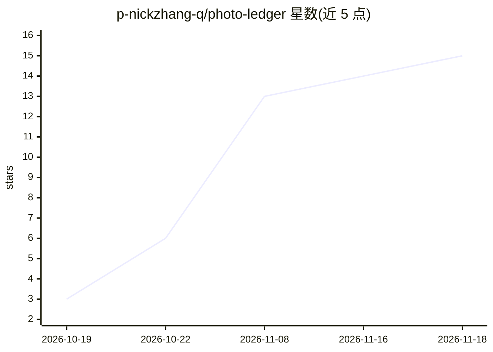

# p-nickzhang-q/photo-ledger

⭐ 15 · Kotlin · MIT · 推送 2026-11-04 · [GitHub](https://github.com/p-nickzhang-q/photo-ledger) · 个人维护 · 中文 README

**离线端侧识别支付截图生成账目的 Android 记账应用**

面向个人用户的 Android 记账应用：从相册或系统分享导入支付宝/微信等支付截图，在手机本地经 PP-OCRv4 OCR 与 Qwen3-0.6B（LiteRT-LM，OpenCL GPU 加速）约束解码完成字段提取，生成账目草稿供用户确认入账。OCR、推理、存储全部端侧完成，截图不离开设备。规则快路径命中时毫秒级出结果，复杂页面降级大模型。需从源码构建（Android Studio/JDK 21），真机需 ≥6GB 内存加载模型。单张提取约 5-10 秒。

## 筛选速览

| 维度 | 判定 | 备注 |
|---|---|---|
| AI 角色 | `ai-native` | 本体是模型或模型工具 |
| 许可风险 | `permissive` | MIT |
| 部署形态 | `None` |  |
| 模型依赖 | — | README 未给出锁定关系 |
| 硬件要求 | — | 无带数字的原话,不猜 |
| 安装摩擦 | `medium` | 含编译或系统依赖之一 |
| 成熟度 | — | 结构信号不足 |

## 能力要点

- PP-OCRv4 端侧 OCR + Qwen3-0.6B 约束解码（JSON Schema 强约束日期/金额/分类）
- 规则快路径：整单截图不经大模型毫秒级出草稿
- 全链路端侧离线，截图与账目不上传任何服务器
- 批量导入（最多 20 张）、内容哈希去重、商户记忆、备份导出

## 适用场景

- 把支付宝/微信支付截图批量转成账目，替代手动记账
- 在不上传截图、不授权支付账号的前提下自动记账
- 按月浏览、搜索、汇总统计消费并导出 CSV/zip 备份

## 场景标签

`OCR` · 领域:感知与多模态

## 证据(README 行号)

> L7: 从相册多选或系统分享支付宝 / 微信等支付的账单截图（支付成功页、账单详情页、订单页），应用在手机本地完成 OCR 识别与大模型字段提取，生成待确认的账目草稿，一键入账。
> L48: 支付截图 → PP-OCRv4 端侧 OCR → 文本后处理（日期/金额规范化、订单块拆分、噪音行丢弃）
> L49:          → 规则快路径；未命中降级 Qwen3-0.6B（LiteRT-LM，OpenCL GPU 加速，约束解码保证输出结构）

## 星数曲线

2026-10-19 3 → 2026-11-18 15（+12）

---
*卡片 v1 · prompt 1.4 · 生成 2026-11-18 · 置信度 high · 依据 README sha `de9c639e22a7` · [字段定义](../../DATASET.md)*
