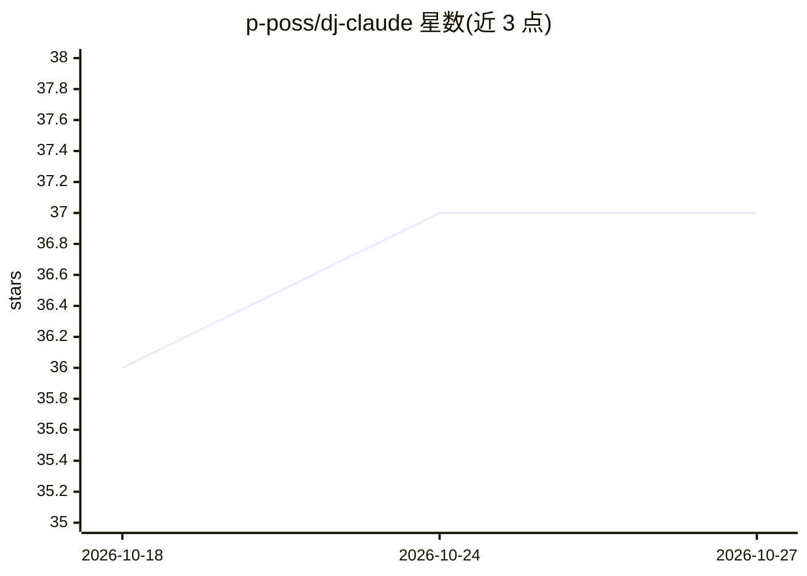

# p-poss/dj-claude

⭐ 37 · TypeScript · AGPL-3.0 · 推送 2026-06-02 · [GitHub](https://github.com/p-poss/dj-claude) · [官网](https://www.claude.dj/) · 个人维护

**供 AI agent 即时作曲演奏的音乐 MCP 服务器，支持多 agent 合奏**

基于 Strudel 实时编程环境的音乐 MCP 服务器：提供 20 个 MCP 工具、3 个资源与 HTTP 传输，多个 AI agent 可经 HTTP 连接共享同一音频引擎与层状态，各自添加鼓、贝斯、旋律等声部并自动合成（stack()）。提供 22 个预设、8 种 vibe、指挥模式、混音快照。所有工具可在无 API key 下运行（预设/直接 Strudel 代码/agent 从资源自学语法）；配置 ANTHROPIC_API_KEY 后可从文本提示生成音乐。运行形式包括 Claude Code 插件、终端 TUI、Web、headless 与 MCP server。

## 筛选速览

| 维度 | 判定 | 备注 |
|---|---|---|
| AI 角色 | `ai-ecosystem` | LLM/agent 周边工具 |
| 许可风险 | `viral` | AGPL-3.0 |
| 部署形态 | `library` | 以包/库形式分发 |
| 模型依赖 | — | README 未给出锁定关系 |
| 硬件要求 | — | 无带数字的原话,不猜 |
| 安装摩擦 | `low` | 无编译、无系统依赖或容器化 |
| 成熟度 | — | 结构信号不足 |

## 能力要点

- 多 agent 经 HTTP 共享音频引擎，声部自动合成（jam 工具族）
- 全部 20 个 MCP 工具支持无 API key 运行（预设/直接 Strudel 代码）
- 3 个 MCP 资源供 agent 自学 Strudel 语法后原创作曲
- 指挥模式按单一指令编排乐队，自动识别 7 种乐队模板

## 适用场景

- 给 Claude Code / Cursor 等 MCP 客户端接入实时配乐能力
- 让多个 agent 在编码或协作时合奏背景音乐
- 脚本化生成并播放指定风格音乐（headless 模式）

## 场景标签

`多智能体` · 领域:Agent 开发

## 证据(README 行号)

> L18: DJ Claude is the only music MCP server with multi-agent collaboration. Multiple AI agents connect over HTTP and jam
> L40: |MCP HTTP server|`npx dj-claude-mcp-http`|Multi-agent jam sessions over HTTP|

## 星数曲线

2026-10-18 36 → 2026-10-27 37（+1）

---
*卡片 v1 · prompt 1.4 · 生成 2026-10-25 · 置信度 high · 依据 README sha `f971ceb9083b` · [字段定义](../../DATASET.md)*
