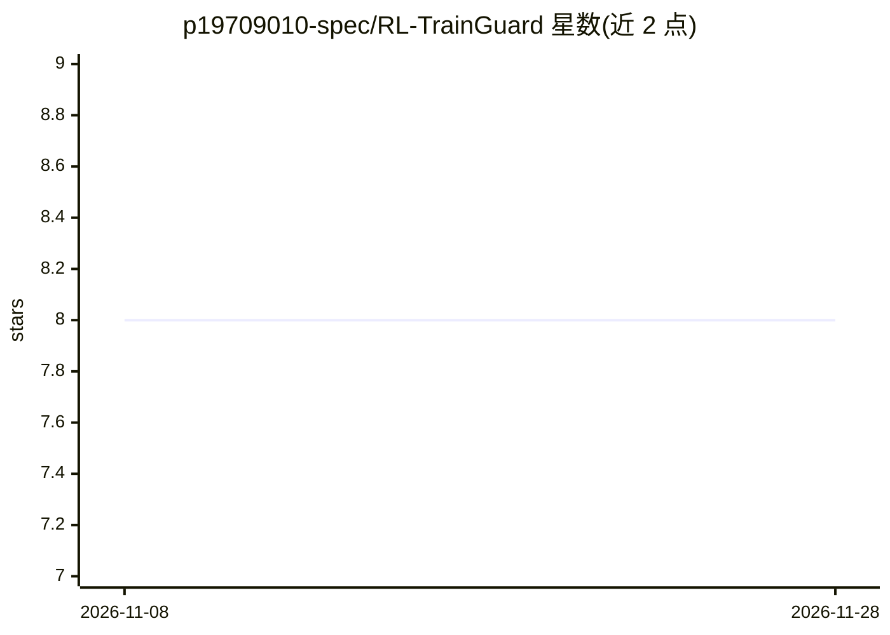

# p19709010-spec/RL-TrainGuard

⭐ 8 · Python · MIT · 推送 2026-10-28 · [GitHub](https://github.com/p19709010-spec/RL-TrainGuard) · 个人维护 · 中文 README

**给 RL/AI 训练者的实时监控仪表盘**

独立训练监控工具：在训练命令前加 `rlguard run --` 即可在浏览器实时查看 CPU/RAM、GPU 利用率与 VRAM、训练进度、ETA、Loss、Reward 和学习率，并通过 SQLite 本地持久化历史 Run 支持多 Run 曲线对比。指标通过 Python API `rlguard.log()` 上报，环境变量自动注入无需额外配置。当前版本仅面向本机单次训练，只采集 GPU 0，不做训练控制与远程多用户认证。

## 筛选速览

| 维度 | 判定 | 备注 |
|---|---|---|
| AI 角色 | `ai-ecosystem` | LLM/agent 周边工具 |
| 许可风险 | `permissive` | MIT |
| 部署形态 | `library` | 以包/库形式分发 |
| 模型依赖 | — | README 未给出锁定关系 |
| 硬件要求 | — | 无带数字的原话,不猜 |
| 安装摩擦 | `low` | 无编译、无系统依赖或容器化 |
| 成熟度 | — | 结构信号不足 |

## 能力要点

- 命令前缀式接入：`rlguard run -- python train.py` 即启监控
- 通过 NVIDIA NVML 采集 GPU 利用率/VRAM/温度/功耗，GPU 不可用自动降级
- SQLite 本地持久化历史 Run，支持 2–3 条 Loss/Reward 曲线对比
- 提供 REST API（status/history/metrics/runs 端点）

## 适用场景

- 强化学习训练时实时查看 Loss/Reward 曲线与 ETA
- 对比多个历史 Run 的训练指标
- 监控训练任务的 CPU/GPU 资源占用

## 场景标签

`MLOps` · 领域:训练与推理

## 证据(README 行号)

> L3: **A Lightweight Real-Time Monitoring Dashboard for AI Training**
> L5: RL-TrainGuard 是一个独立、通用的训练监控工具。只需在训练命令前加上 `rlguard run --`，就可以在浏览器中实时查看硬件资源、训练进度、ETA、Loss、Reward、学习率，以及本地保存的历史 Run 对比

## 星数曲线

2026-11-08 8 → 2026-11-28 8（+0）

---
*卡片 v1 · prompt 1.4 · 生成 2026-11-20 · 置信度 high · 依据 README sha `44de7d675134` · [字段定义](../../DATASET.md)*
