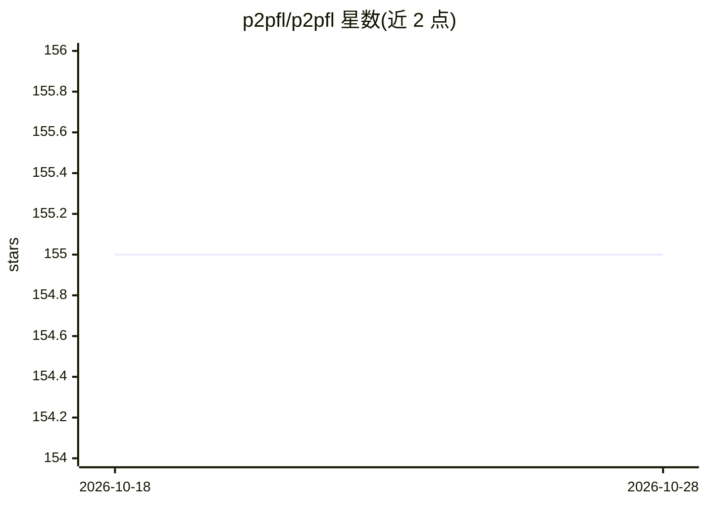

# p2pfl/p2pfl

⭐ 155 · Jupyter Notebook · GPL-3.0 · 推送 2026-10-19 · [GitHub](https://github.com/p2pfl/p2pfl) · [官网](https://p2pfl.com) · 组织维护

**去中心化联邦学习库：在 P2P 网络上协同训练模型**

通用开源库，用于在真实或模拟环境中执行去中心化联邦学习：基于 P2P 网络与 gossip 协议进行节点通信，无需中心服务器即可协同训练模型。支持 PyTorch、TensorFlow/Keras、JAX 模型，通信协议可选（如 gRPC），提供 Hugging Face Datasets、Ray 大规模模拟等集成，并带 Web Services 平台实时监控实验。面向需要联邦学习系统的研究与开发场景，以 pip 包、源码与 Docker 形式安装，GPL-3.0 许可。

## 筛选速览

| 维度 | 判定 | 备注 |
|---|---|---|
| AI 角色 | `ai-ecosystem` | LLM/agent 周边工具 |
| 许可风险 | `viral` | GPL-3.0 |
| 部署形态 | `self-host` | docker 或自建部署 |
| 模型依赖 | — | README 未给出锁定关系 |
| 硬件要求 | — | 无带数字的原话,不猜 |
| 安装摩擦 | `low` | 无编译、无系统依赖或容器化 |
| 成熟度 | — | 结构信号不足 |

## 能力要点

- 基于 P2P 网络与 gossip 协议的去中心化联邦学习执行
- 支持 PyTorch / TensorFlow(Keras) / JAX 模型
- 模拟与真实环境两种实验模式
- Ray 大规模模拟、Hugging Face Datasets、gRPC 等集成

## 适用场景

- 在没有中心服务器的节点间协同训练深度学习模型
- 模拟或真实网络环境下实验去中心化联邦学习算法
- 通过 Web Services 平台跟踪联邦学习实验进度

## 场景标签

`模型训练` · 领域:训练与推理

## 证据(README 行号)

> L14: P2PFL is a general-purpose open-source library designed for the execution (simulated and in real environments) of D
> L29: |🧠 ML Frameworks|Seamlessly integrate PyTorch, TensorFlow/Keras, and JAX models.|

## 星数曲线

2026-10-18 155 → 2026-10-28 155（+0）

---
*卡片 v1 · prompt 1.4 · 生成 2026-10-22 · 置信度 high · 依据 README sha `3f8b5444ac9e` · [字段定义](../../DATASET.md)*
