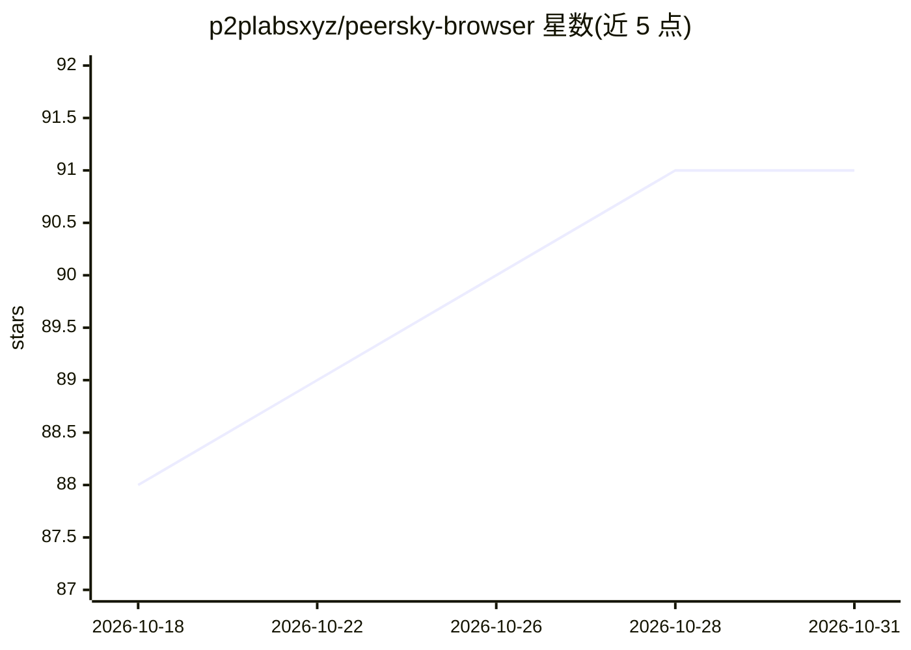

# p2plabsxyz/peersky-browser

⭐ 91 · JavaScript · MIT · 推送 2026-10-29 · [GitHub](https://github.com/p2plabsxyz/peersky-browser) · [官网](https://peersky.p2plabs.xyz/) · 组织维护

**本地优先的点对点浏览器：让电脑成为节点访问 P2P 网络**

基于 JavaScript/Electron 开发流程的点对点 Web 浏览器：将用户电脑变为网络节点（服务器），页面与应用可来自持有它们的对等节点而非中心服务器；支持 IPFS、Hyper、HyperSwap、BitTorrent 等协议处理器，并附带聊天、协同编辑、文件共享、音乐播放器和本地 AI 等应用，多数可在无互联网的本地网络运行。提供下载入口与 npm 源码开发构建流程，MIT 许可。

## 筛选速览

| 维度 | 判定 | 备注 |
|---|---|---|
| AI 角色 | `ai-enhanced` | 去掉 AI 部分产品仍成立 |
| 许可风险 | `permissive` | MIT |
| 部署形态 | `library` | 以包/库形式分发 |
| 模型依赖 | — | README 未给出锁定关系 |
| 硬件要求 | — | 无带数字的原话,不猜 |
| 安装摩擦 | `low` | 无编译、无系统依赖或容器化 |
| 成熟度 | `idea` | |

## 能力要点

- 将本机作为节点，支持 IPFS/Hyper/HS/BitTorrent 协议处理
- 附带 P2P 应用生态：聊天、协同编辑、文件共享、本地 AI 等
- 多数应用可在无互联网的本地网络运行
- 提供备份、恢复与身份迁移功能及测试套件

## 适用场景

- 访问 IPFS/Hyper 等去中心化网络上的页面与应用
- 在本地网络无互联网环境下使用聊天与文件共享
- 以节点身份参与点对点网络、自持数据与工具

## 场景标签

 · 领域:去中心化网络/浏览器

## 证据(README 行号)

> L16: PeerSky is a gateway to the peer-to-peer web, not just a browser. It turns your computer into a node (a server for 
> L89: npm run test:p2p          # Protocol handler unit tests (IPFS/Hyper/HS/BitTorrent)

## 星数曲线

2026-10-18 88 → 2026-10-31 91（+3）

---
*卡片 v1 · prompt 1.4 · 生成 2026-10-23 · 置信度 mid · 依据 README sha `8d1ce0d47f2b` · [字段定义](../../DATASET.md)*
