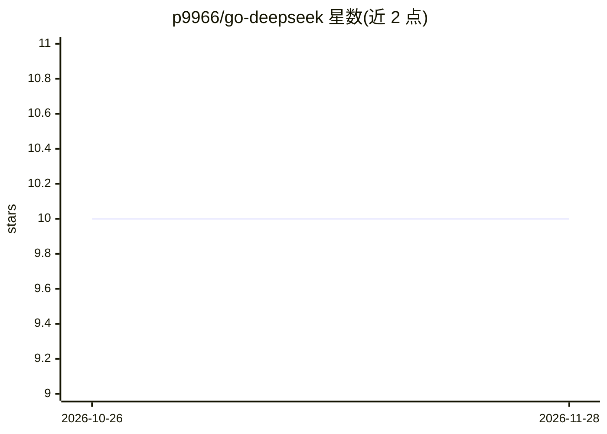

# p9966/go-deepseek

⭐ 10 · Go · MIT · 推送 2026-04-24 · [GitHub](https://github.com/p9966/go-deepseek) · [官网](https://pkg.go.dev/github.com/p9966/go-deepseek) · 个人维护

**面向 Go 开发者的 DeepSeek 兼容 API 客户端库**

一个非官方的 Go 语言客户端库，用于调用 DeepSeek 兼容 API，支持对话补全、流式输出、函数调用、FIM 补全、通过 Ollama 的嵌入向量，以及 DeepSeek 账户余额查询。默认指向 DeepSeek 官方端点，可通过 BaseURL 配置接入 DashScope（Qwen3/QwQ）、OpenAI 兼容端点及本地 Ollama 模型，支持自定义超时与 http.Client。通过 go get 安装，要求 Go 1.23+，examples/ 目录提供 15 个可运行示例。

## 筛选速览

| 维度 | 判定 | 备注 |
|---|---|---|
| AI 角色 | `ai-ecosystem` | LLM/agent 周边工具 |
| 许可风险 | `permissive` | MIT |
| 部署形态 | `None` |  |
| 模型依赖 | local-ok | 支持本地模型 |
| 硬件要求 | — | 无带数字的原话,不猜 |
| 安装摩擦 | `low` | 无编译、无系统依赖或容器化 |
| 成熟度 | — | 结构信号不足 |

## 能力要点

- 支持聊天补全、流式输出、函数调用与 FIM 补全
- 默认 DeepSeek 端点，可配置接入 DashScope、OpenAI 兼容端点与本地 Ollama
- 提供余额查询与可配置超时、自定义 http.Client
- examples/ 目录含 15 个可运行示例

## 适用场景

- 在 Go 项目中接入 DeepSeek 对话与函数调用能力
- 通过同一客户端切换 Qwen3/QwQ、OpenAI 兼容端点
- 配合本地 Ollama 运行 deepseek-r1 等模型

## 场景标签

 · 领域:LLM 基础设施/客户端库

## 证据(README 行号)

> L5: `go-deepseek` is an unofficial Go client for DeepSeek-compatible APIs. It can be used with DeepSeek, Qwen3/QwQ via D
> L16: ## Installation

## 星数曲线

2026-10-26 10 → 2026-11-28 10（+0）

---
*卡片 v1 · prompt 1.4 · 生成 2026-11-19 · 置信度 high · 依据 README sha `e5f814b0de97` · [字段定义](../../DATASET.md)*
