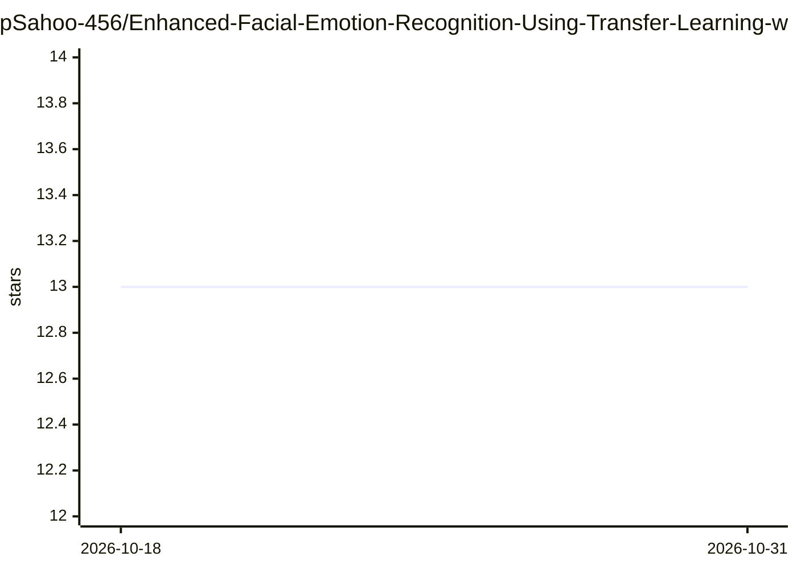

# pSahoo-456/Enhanced-Facial-Emotion-Recognition-Using-Transfer-Learning-with-ResNet152

⭐ 13 · Jupyter Notebook · MIT · 推送 2025-11-26 · [GitHub](https://github.com/pSahoo-456/Enhanced-Facial-Emotion-Recognition-Using-Transfer-Learning-with-ResNet152) · 个人维护

**基于 ResNet152 迁移学习的人脸表情识别系统，分类六种情绪**

在 ImageNet 预训练的 ResNet152 上做迁移学习的人脸表情识别（FER）系统，识别 Happy、Angry、Sad、Neutral、Surprise、Ahegao 六类情绪，报告自定义数据集上 84% 准确率。数据经人脸裁剪、归一化与旋转/缩放/翻转等增强，训练数据来自 YouTube、社交媒体与 AffectNet/IMDB 等公开数据集（原始数据因隐私与许可不公开）。以 Streamlit 应用形式交付，模型文件约 690MB 需从 release 下载或用附带 Jupyter notebook 重训。工作发表于 2024 年 IC-SIT 会议。

## 筛选速览

| 维度 | 判定 | 备注 |
|---|---|---|
| AI 角色 | `ai-native` | 本体是模型或模型工具 |
| 许可风险 | `permissive` | MIT |
| 部署形态 | `library` | 以包/库形式分发 |
| 模型依赖 | — | README 未给出锁定关系 |
| 硬件要求 | — | 无带数字的原话,不猜 |
| 安装摩擦 | `low` | 无编译、无系统依赖或容器化 |
| 成熟度 | — | 结构信号不足 |

## 能力要点

- ResNet152 迁移学习分类 6 种情绪，报告 84% 准确率
- 数据增强（旋转/缩放/平移/翻转/亮度）与归一化预处理
- 提供分类报告与混淆矩阵等评估指标
- Streamlit 应用交付，含重训用 Jupyter notebook

## 适用场景

- 上传人脸图像进行情绪分类演示
- 复现迁移学习 FER 训练流程用于教学或研究
- 在公开表情数据集上重训并评估模型

## 场景标签

`图像视频处理` · 领域:感知与多模态

## 证据(README 行号)

> L15: This repository presents a **Facial Emotion Recognition (FER)** system built using **ResNet152**, leveraging transf
> L25: While classical machine learning approaches struggle to jointly optimize feature extraction and classification, mod

## 星数曲线

2026-10-18 13 → 2026-10-31 13（+0）

---
*卡片 v1 · prompt 1.4 · 生成 2026-10-31 · 置信度 mid · 依据 README sha `a4083b67c136` · [字段定义](../../DATASET.md)*
