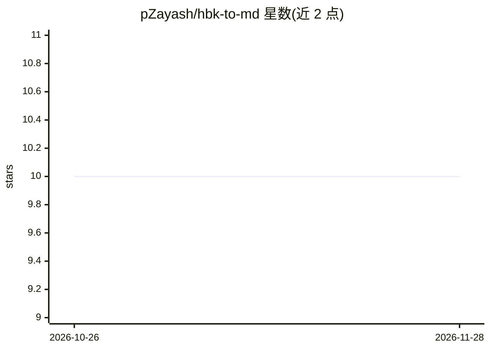

# pZayash/hbk-to-md

⭐ 10 · Python · 推送 2026-06-19 · [GitHub](https://github.com/pZayash/hbk-to-md) · 个人维护

**1C .hbk 帮助档案转 Markdown vault 的 CLI 转换器**

读取 1C:Предприятие 平台的 .hbk 帮助归档（shcntx_ru.hbk / shlang_ru.hbk），经 onec_dtools 与 stdlib zipfile 两级解包，将 HTML 页面逐页转换为 Markdown 文件，重写 v8help:// 内部链接为相对 .md 链接，并生成 _index 索引与面包屑导航层。输出可直接作为 Obsidian vault 打开，或用于 RAG/索引流程。需 Python ≥ 3.10，不需要 7z/V8unpack 外部工具。

## 筛选速览

| 维度 | 判定 | 备注 |
|---|---|---|
| AI 角色 | `ai-enhanced` | 去掉 AI 部分产品仍成立 |
| 许可风险 | `none` | — |
| 部署形态 | `library` | 以包/库形式分发 |
| 模型依赖 | — | README 未给出锁定关系 |
| 硬件要求 | — | 无带数字的原话,不猜 |
| 安装摩擦 | `low` | 无编译、无系统依赖或容器化 |
| 成熟度 | — | 结构信号不足 |

## 能力要点

- 两步解包 .hbk，无需 7z/V8unpack 外部工具
- HTML→Markdown 转换并重写 v8help:// 为相对链接
- 生成 _index*.md 索引与每页 breadcrumb 导航
- 输出 _meta.json、冲突/截断/未解析链接等运行报告

## 适用场景

- 把 1C 内置帮助转成 Obsidian vault 浏览
- 为 1C 文档构建 RAG/索引数据源
- 用新版平台 .hbk 重新生成文档库

## 场景标签

`文档解析` · 领域:知识与检索

## 证据(README 行号)

> L3: CLI-конвертер `.hbk` (1С:Предприятие) -> плоский каталог `.md` для Obsidian, индексирования и AI/RAG-пайплайнов.
> L48: Каталог `vault/` содержит готовую выгрузку справки 1С:Предприятие 8.3.27.1786, сгенерированную из `shcntx_ru.hbk` +

## 星数曲线

2026-10-26 10 → 2026-11-28 10（+0）

---
*卡片 v1 · prompt 1.4 · 生成 2026-11-19 · 置信度 mid · 依据 README sha `310b1766596e` · [字段定义](../../DATASET.md)*
