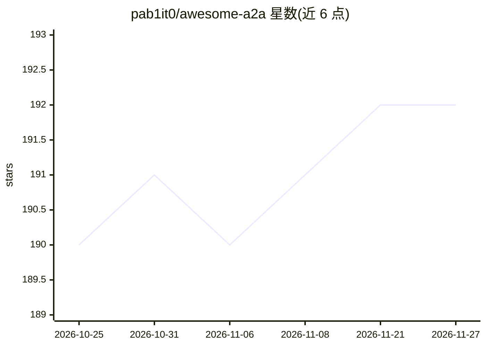

# pab1it0/awesome-a2a

⭐ 192 · MIT · 推送 2026-11-22 · [GitHub](https://github.com/pab1it0/awesome-a2a) · [官网](https://github.com/pab1it0/awesome-a2a) · 个人维护

**A2A 协议服务器、客户端与教程的策展清单**

收录并组织符合 Agent2Agent (A2A) 协议的开源服务器实现，按官方示例、位置服务、商业工具、图像生成、金融服务、搜索与数据提取等类别编排；条目以图标标注官方实现状态、编程语言、本地/云部署与支持的操作系统。A2A 是 Google 发起的开放协议，用于不同 AI agent 通过标准接口发现能力、提交任务、监控进度与获取结果。清单面向希望构建可互操作 AI agent 系统的开发者，另含客户端列表与入门教程链接。

## 筛选速览

| 维度 | 判定 | 备注 |
|---|---|---|
| AI 角色 | `ai-knowledge` | 知识聚合/清单类 |
| 许可风险 | `permissive` | MIT |
| 部署形态 | `library` | 以包/库形式分发 |
| 模型依赖 | — | README 未给出锁定关系 |
| 硬件要求 | — | 无带数字的原话,不猜 |
| 安装摩擦 | `low` | 无编译、无系统依赖或容器化 |
| 成熟度 | — | 结构信号不足 |

## 能力要点

- 按 13 个服务类别组织 A2A 服务器实现清单
- 图标标注语言/部署方式（本地/云）/操作系统
- 区分官方实现与社区实现（🎖️ 标记）
- 附 A2A 客户端列表与入门教程链接

## 适用场景

- 为 agent 系统查找符合 A2A 协议的现成服务器实现
- 了解 Google A2A 协议的官方示例与用法
- 按类别（金融/位置/图像等）寻找可互操作的 agent 服务

## 场景标签

`精选清单` · 领域:学习与行业

## 证据(README 行号)

> L5: A curated list of awesome Agent2Agent (A2A) protocol servers. This repository collects and organizes A2A-compliant s
> L52: ## Server Implementations

## 星数曲线

2026-10-25 190 → 2026-11-27 192（+2）

---
*卡片 v1 · prompt 1.4 · 生成 2026-11-25 · 置信度 mid · 依据 README sha `ac91fbcdc792` · [字段定义](../../DATASET.md)*
