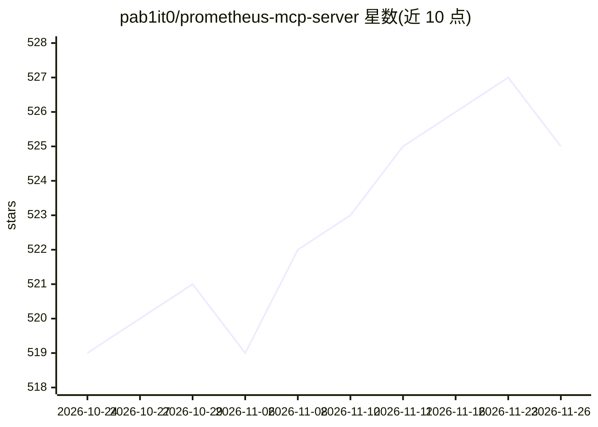

# pab1it0/prometheus-mcp-server

⭐ 525 · Python · MIT · 推送 2026-11-14 · [GitHub](https://github.com/pab1it0/prometheus-mcp-server) · 个人维护

**让 AI 助手通过 MCP 协议查询和分析 Prometheus 指标的服务器**

实现 Model Context Protocol 的服务器，将 Prometheus 指标查询能力暴露给 MCP 兼容客户端。提供 6 类工具：health_check、PromQL 即时/区间查询、指标列表（分页与过滤）、指标元数据、抓取目标查询；工具清单可配置以控制上下文占用。支持 Basic/Bearer/mTLS 认证、stdio/http/sse 三种传输、多实例 TOOL_PREFIX、无状态 HTTP 多副本部署。可通过 Docker、Claude Code CLI、Docker Desktop MCP Toolkit 或 Helm Chart 部署到 Kubernetes。

## 筛选速览

| 维度 | 判定 | 备注 |
|---|---|---|
| AI 角色 | `ai-ecosystem` | LLM/agent 周边工具 |
| 许可风险 | `permissive` | MIT |
| 部署形态 | `self-host` | docker 或自建部署 |
| 模型依赖 | — | README 未给出锁定关系 |
| 硬件要求 | — | 无带数字的原话,不猜 |
| 安装摩擦 | `low` | 无编译、无系统依赖或容器化 |
| 成熟度 | — | 结构信号不足 |

## 能力要点

- 提供 6 个 MCP 工具：PromQL 即时/区间查询、指标发现、元数据与抓取目标
- 支持 Basic/Bearer/mTLS 多种认证与多租户 ORG_ID
- stdio/http/sse 三种传输模式，支持无状态 HTTP 多副本部署
- 提供 Helm Chart 部署到 Kubernetes，工具清单可配置

## 适用场景

- 在 Claude Desktop / VS Code / Cursor 等客户端中用自然语言查询监控指标
- 让 AI 助手浏览与检索大规模 Prometheus 指标元数据
- 用 Helm 在 Kubernetes 集群中部署多副本 MCP 服务

## 场景标签

 · 领域:DevOps/可观测性基础设施

## 证据(README 行号)

> L12: A [Model Context Protocol][mcp] (MCP) server that provides access to your Prometheus metrics and queries through st
> L19: - MCP-compatible client (Claude Desktop, VS Code, Cursor, Windsurf, etc.)
> L138: |`execute_query`|Query|Execute a PromQL instant query against Prometheus|

## 星数曲线

2026-10-24 519 → 2026-11-26 525（+6）

---
*卡片 v1 · prompt 1.4 · 生成 2026-11-25 · 置信度 high · 依据 README sha `525d7c288041` · [字段定义](../../DATASET.md)*
