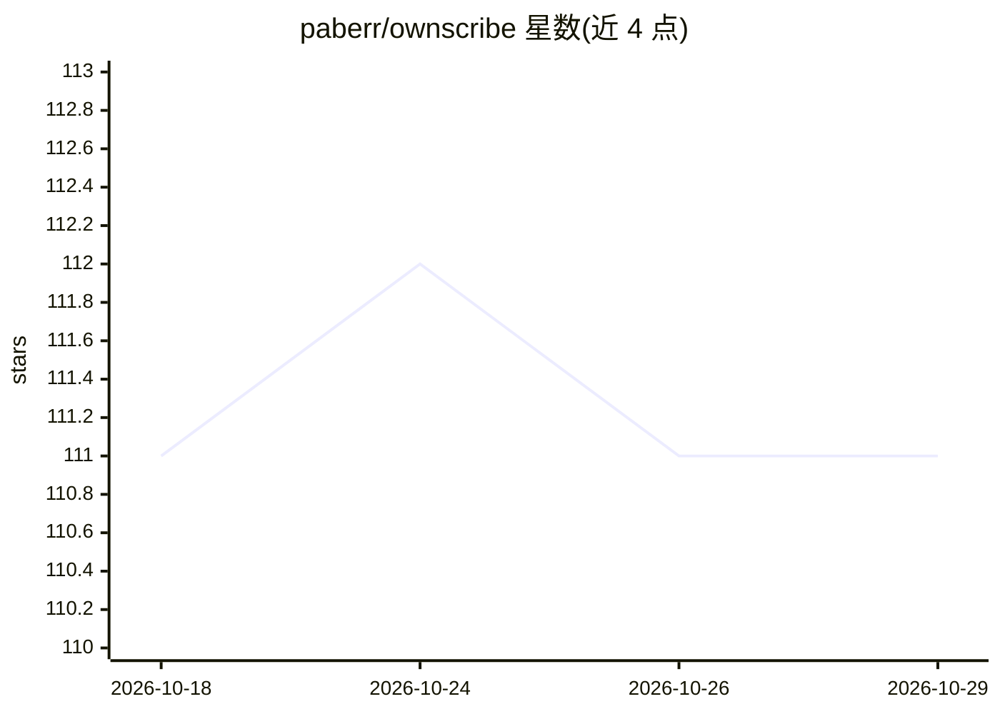

# paberr/ownscribe

⭐ 111 · Python · MIT · 推送 2026-08-14 · [GitHub](https://github.com/paberr/ownscribe) · 个人维护

**本地优先的会议录音转录与摘要命令行工具**

在用户本机完成录音、转录与会议纪要生成的 CLI：通过 Core Audio Taps 捕获 macOS 系统音频与麦克风，用 WhisperX 做带词级时间戳的转录，可选 pyannote 说话人分离（需 HuggingFace token）；摘要默认用内置本地模型 Phi-4-mini（约 2.4 GB，首运行自动下载），也可切换 Ollama 或任意 OpenAI 兼容服务。支持跨会议记录的自然语言问答、摘要模板与长会议分块合并。系统音频捕获仅限 macOS 14.2+ Apple Silicon，转写与摘要在任意平台可用。

## 筛选速览

| 维度 | 判定 | 备注 |
|---|---|---|
| AI 角色 | `ai-native` | 本体是模型或模型工具 |
| 许可风险 | `permissive` | MIT |
| 部署形态 | `library` | 以包/库形式分发 |
| 模型依赖 | local-ok | 支持本地模型 |
| 硬件要求 | — | 无带数字的原话,不猜 |
| 安装摩擦 | `medium` | 含编译或系统依赖之一 |
| 成熟度 | — | 结构信号不足 |

## 能力要点

- Core Audio Taps 原生捕获系统音频，无需虚拟声卡驱动
- WhisperX 转录带词级时间戳，可选 pyannote 说话人分离
- 内置 Phi-4-mini 本地摘要模型，可选 Ollama / OpenAI 兼容后端
- ask 子命令跨会议记录自然语言问答（两阶段 LLM 流水线 + 关键词回退）

## 适用场景

- 录制线上会议并自动生成含行动项的本地会议纪要
- 对全部历史会议记录用自然语言提问检索
- 把已有的音视频文件转成文字稿和摘要

## 场景标签

`语音识别` `AI 写作` `文档问答` · 领域:内容生成

## 证据(README 行号)

> L32: - **WhisperX transcription** — fast, accurate speech-to-text with word-level timestamps
> L35: - **Local LLM summarization** — structured meeting notes with a built-in model (Phi-4-mini); also supports Ollama, 
> L9: Record, transcribe, and summarize meetings and system audio entirely on your machine – no cloud, no bots, no data le

## 星数曲线

2026-10-18 111 → 2026-10-29 111（+0）

---
*卡片 v1 · prompt 1.4 · 生成 2026-10-23 · 置信度 high · 依据 README sha `b41226e0898d` · [字段定义](../../DATASET.md)*
