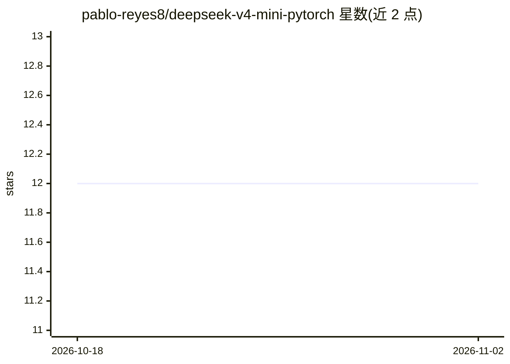

# pablo-reyes8/deepseek-v4-mini-pytorch

⭐ 12 · Python · MIT · 推送 2026-09-06 · [GitHub](https://github.com/pablo-reyes8/deepseek-v4-mini-pytorch) · 个人维护 · 中文 README

**DeepSeek-V4 架构的从零 PyTorch 复现，供研究消融与迷你训练**

非官方、从零实现的 DeepSeek-V4 核心架构小型化 PyTorch 代码库：覆盖混合压缩注意力（HCA/CSA）、MoE 路由、流形约束超连接（mHC）、多 token 预测（MTP）与 Muon 训练引擎。提供纯 PyTorch 推理路径（三种缓存模式）、7 个数据集预设（TinyStories/WikiText-2/MiniPile 等）、六套消融实验套件（A1-A6）以及 DDP/层间模型并行支持。明确声明不隶属 DeepSeek-AI，不复现官方权重与生产内核；默认面向 CPU 安全测试，测试套件 756 通过。提供 CLI 工具与 Docker 构建。

## 筛选速览

| 维度 | 判定 | 备注 |
|---|---|---|
| AI 角色 | `ai-native` | 本体是模型或模型工具 |
| 许可风险 | `permissive` | MIT |
| 部署形态 | `self-host` | docker 或自建部署 |
| 模型依赖 | — | README 未给出锁定关系 |
| 硬件要求 | — | 无带数字的原话,不猜 |
| 安装摩擦 | `low` | 无编译、无系统依赖或容器化 |
| 成熟度 | — | 结构信号不足 |

## 能力要点

- 从零实现 HCA/CSA 压缩注意力、MoE、mHC、MTP 与 Muon 优化器
- 六套高层消融实验套件（注意力/压缩/mHC/MoE/MTP/组合）
- DDP 数据并行与层间模型并行，CPU 可验证
- 四种 CLI 工具与 Docker 构建，CPU 安全测试套件

## 适用场景

- 在小规模语料上研究和消融 DeepSeek-V4 各架构组件
- 教学或复现压缩注意力与 MoE 路由机制
- 在 CPU 上跑迷你语言模型训练与推理实验

## 场景标签

`模型训练` · 领域:训练与推理

## 证据(README 行号)

> L10: An unofficial, ground-up PyTorch implementation of the core architectural ideas behind **DeepSeek-V4**. The project
> L12: This repository is not a toy Transformer wrapper or a production model clone. It implements the mechanisms that mak
> L29: This project isolates those innovations into a mini implementation where each component can be tested, ablated, and

## 星数曲线

2026-10-18 12 → 2026-11-02 12（+0）

---
*卡片 v1 · prompt 1.4 · 生成 2026-11-01 · 置信度 high · 依据 README sha `3bfc35f97cd2` · [字段定义](../../DATASET.md)*
