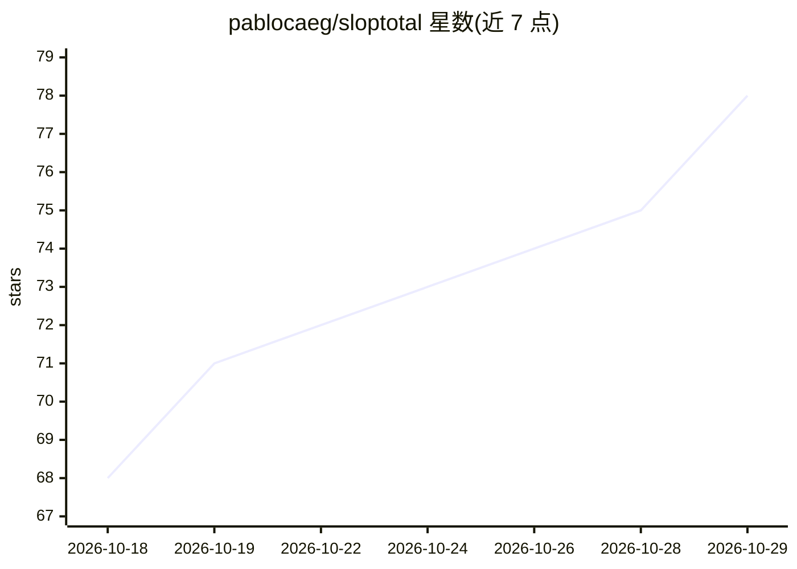

# pablocaeg/sloptotal

⭐ 78 · Python · MIT · 推送 2026-10-24 · [GitHub](https://github.com/pablocaeg/sloptotal) · [官网](https://sloptotal.com) · 个人维护 · 中文 README

**自托管开源 AI 文本检测器：23 引擎并行，输出单一校准分数**

面向需要本地检测 AI 生成文本的用户：可粘贴文本、输入 URL 或上传 PDF/Word 文件，23 个独立检测引擎（DeBERTa/RoBERTa 神经分类器、Fast-DetectGPT、Binoculars、困惑度统计检验、语言学启发式）并行评分，经逻辑回归校准集成输出 0-100 分与判定档位，可逐引擎查看意见。所有准确率在公开 SlopBench 基准上测量（AUC 0.942）。附网站 AI 建站工具指纹检查。CPU 即可运行（精简配置 4GB 内存），无需第三方 AI API，首次扫描下载约 2GB 模型。中文等语言尚不可靠，80 词以下信号弱，README 明示局限。

## 筛选速览

| 维度 | 判定 | 备注 |
|---|---|---|
| AI 角色 | `ai-native` | 本体是模型或模型工具 |
| 许可风险 | `permissive` | MIT |
| 部署形态 | `self-host` | docker 或自建部署 |
| 模型依赖 | — | README 未给出锁定关系 |
| 硬件要求 | `cpu-ok` | |
| 安装摩擦 | `low` | 无编译、无系统依赖或容器化 |
| 成熟度 | — | 结构信号不足 |

## 能力要点

- 23 个检测引擎并行评分，校准集成输出单一分数
- 准确率在公开 SlopBench 基准测量并公布原始数据（AUC 0.942）
- 自托管 CPU 运行，4GB 内存即可跑精简配置，无第三方 API
- 附带检测 7 种 AI 应用建站工具（Lovable/v0/Bolt 等）指纹的网站检查功能
- 提供 JSON API、Chrome 扩展与逐段热力图

## 适用场景

- 我想在不把文本发到第三方的前提下检测其是否为 AI 生成
- 我想看到多个检测引擎各自的评分而非单一模型结论
- 我想检查某个网站是否由 AI 建站工具（Lovable/v0/Bolt 等）搭建
- 批量检测 URL 或短文本片段的 AI 含量

## 场景标签

 · 领域:AI 内容检测

## 证据(README 行号)

> L14: **VirusTotal for AI-generated text.** Paste text, drop in a PDF or Word file, or
> L31: - **23 detection engines, one calibrated score.** DeBERTa and RoBERTa

## 星数曲线

2026-10-18 68 → 2026-10-29 78（+10）

---
*卡片 v1 · prompt 1.4 · 生成 2026-10-24 · 置信度 mid · 依据 README sha `5698b753a3a9` · [字段定义](../../DATASET.md)*
