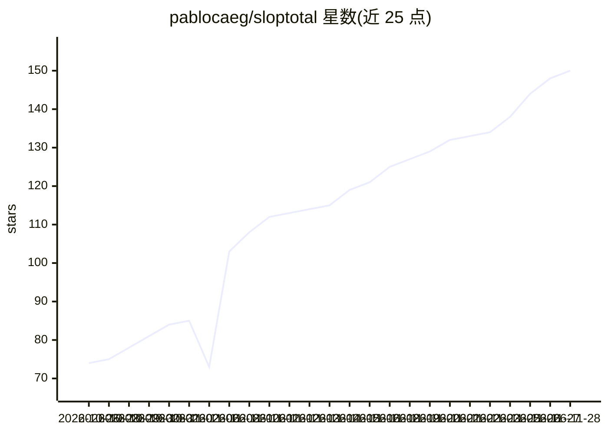

# pablocaeg/sloptotal

⭐ 150 · Python · MIT · 推送 2026-11-27 · [GitHub](https://github.com/pablocaeg/sloptotal) · [官网](https://sloptotal.com) · 个人维护 · 中文 README

**自托管的 AI 生成文本检测器：23 引擎并行评分**

自托管 Web 服务与 API：粘贴文本、上传 PDF/Word/URL，23 个独立检测引擎（DeBERTa/RoBERTa 分类器、Binoculars、Fast-DetectGPT、GLTR、困惑度与句式启发式）并行评分，经校准集成输出 0-100 总分与逐引擎结果。全部模型加载到本地 CPU 运行，扫描内容不离开本机；准确率数字在自建 SlopBench 公开基准上测量并公开失败案例。需约 12 GB 内存与 9 GB 磁盘，无需 GPU 与 API key；另提供 MCP server 供 Claude Code/Cursor 等 agent 调用。

## 筛选速览

| 维度 | 判定 | 备注 |
|---|---|---|
| AI 角色 | `ai-native` | 本体是模型或模型工具 |
| 许可风险 | `permissive` | MIT |
| 部署形态 | `self-host` | docker 或自建部署 |
| 模型依赖 | — | README 未给出锁定关系 |
| 硬件要求 | `cpu-ok` | |
| 安装摩擦 | `low` | 无编译、无系统依赖或容器化 |
| 成熟度 | — | 结构信号不足 |

## 能力要点

- 23 个检测引擎并行评分并输出逐引擎可查的校准总分
- 支持文本、URL 与 .pdf/.docx/.txt/.md 文档及逐段落热图
- SlopBench 基准上测量准确率（AUC 0.942），公开语料与原始分数
- MCP server 提供 analyze_text/analyze_url/check_website_builder 工具

## 适用场景

- 检查一段文本是否为 AI 生成并查看各引擎依据
- 检测网站是否由 Lovable/v0 等 AI 应用构建器生成
- 在本机私密环境下批量检测文档或搜索结果页

## 场景标签

`模型评测` · 领域:评测与运维

## 证据(README 行号)

> L16: **VirusTotal for AI-generated text.** Paste text, drop in a PDF or Word file, or
> L22: It is a free, self-hosted, open-source alternative to hosted AI content
> L20: engine. It runs on your own CPU, so nothing you scan leaves your machine.

## 星数曲线

2026-10-26 74 → 2026-11-28 150（+76）

---
*卡片 v1 · prompt 1.4 · 生成 2026-11-28 · 置信度 high · 依据 README sha `531c9449522d` · [字段定义](../../DATASET.md)*
