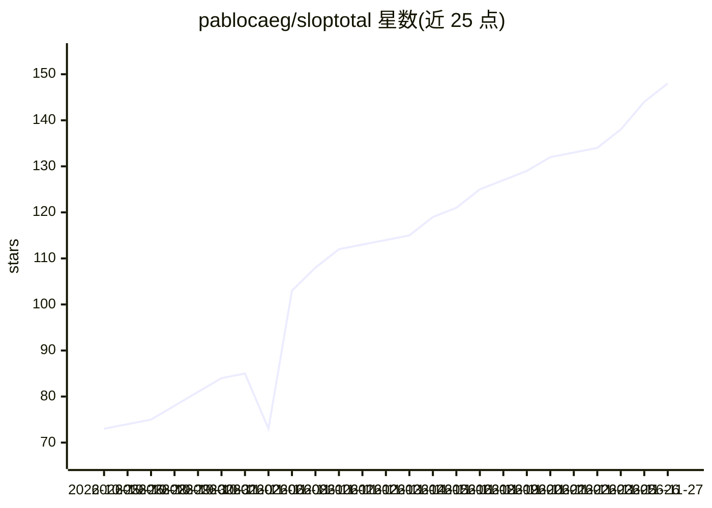

# pablocaeg/sloptotal

⭐ 148 · Python · MIT · 推送 2026-11-23 · [GitHub](https://github.com/pablocaeg/sloptotal) · [官网](https://sloptotal.com) · 个人维护 · 中文 README

**自托管 AI 文本检测器：23 个引擎，输出一个校准分数**

粘贴文本、上传 PDF/Word 文件或提供 URL，系统并行运行 23 个独立检测引擎（神经分类器、统计检验、语言启发式），校准集成将其投票转为一个可逐引擎查看的判定分数。检测在本地 CPU 上运行，扫描内容不出本机，无第三方 AI API。所有准确率数据基于公开基准 SlopBench（1,626 条人类文本 + 1,626 条 AI 文本）测量并公开。支持 9 种语言，提供 JSON API 与 Chrome 扩展。

## 筛选速览

| 维度 | 判定 | 备注 |
|---|---|---|
| AI 角色 | `ai-native` | 本体是模型或模型工具 |
| 许可风险 | `permissive` | MIT |
| 部署形态 | `self-host` | docker 或自建部署 |
| 模型依赖 | — | README 未给出锁定关系 |
| 硬件要求 | `cpu-ok` | |
| 安装摩擦 | `low` | 无编译、无系统依赖或容器化 |
| 成熟度 | — | 结构信号不足 |

## 能力要点

- 23 个检测引擎并行评分，经校准集成输出单一分数
- 准确率数字基于公开基准 SlopBench，附语料与逐样本分数
- CPU 即可运行，加载模型约需 8.3 GB 内存，GPU 可选
- 站点检查识别 Lovable、v0、Bolt 等 AI 构建器部署指纹

## 适用场景

- 检测学生论文或投稿是否为 AI 生成
- 自托管扫描网站内容是否由 AI 应用构建器生成
- 批量对文本、URL 或文档段落做 AI 检测并查看逐引擎评分

## 场景标签

 · 领域:内容检测/文本分析

## 证据(README 行号)

> L16: give it a URL. Twenty-three independent AI detectors (neural classifiers,
> L19: engine. It runs on your own CPU, so nothing you scan leaves your machine.
> L21: It is a free, self-hosted, open-source alternative to hosted AI content

## 星数曲线

2026-10-25 73 → 2026-11-27 148（+75）

---
*卡片 v1 · prompt 1.4 · 生成 2026-11-27 · 置信度 high · 依据 README sha `98c8058aa30a` · [字段定义](../../DATASET.md)*
